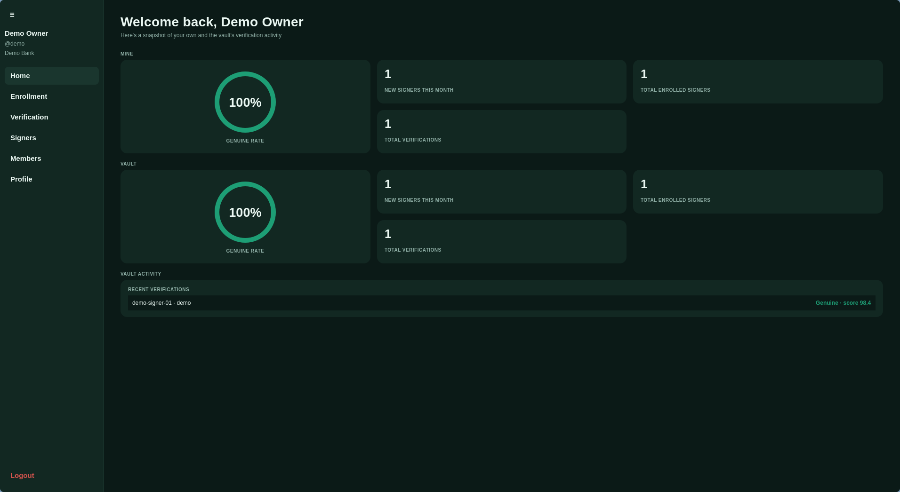
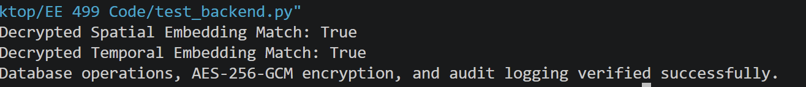
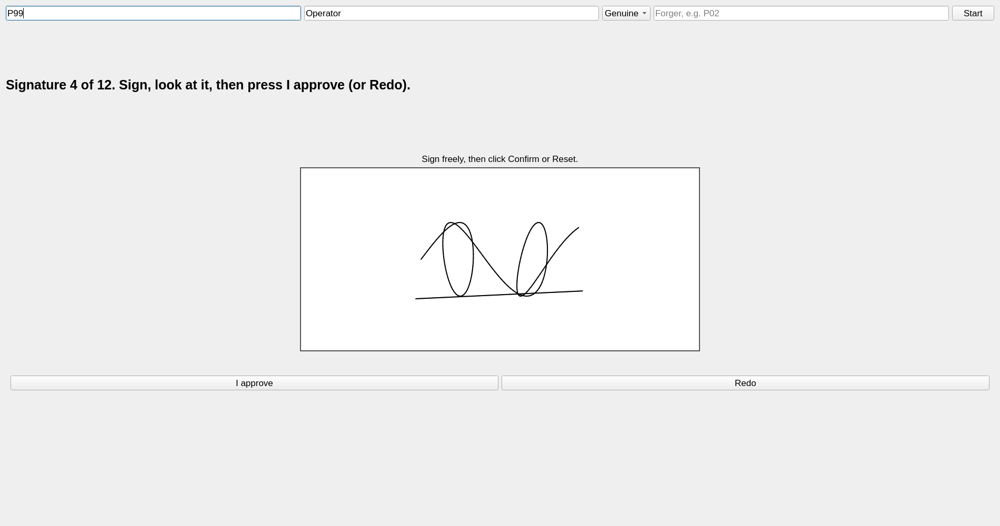
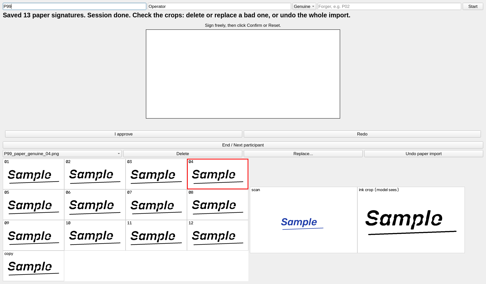

# Signature Verification System

[](https://www.python.org/)
[](https://pytorch.org/)
[](LICENSE)
[]()

> **Senior Design Project (EE 499)** — Department of Electrical and Computer Engineering, King Abdulaziz University (KAU), Jeddah, Saudi Arabia — Team 06

A multimodal signature verification system built with dual Siamese deep neural networks. It verifies signatures using both **offline** (scanned images) and **online** (dynamic tablet pen strokes) inputs, combining their scores via late fusion to detect genuine signatures and skilled forgeries.

This document covers installation, quickstart, project structure, evaluation benchmarks, and architectural comparisons.

---

## Contents

- [Architecture](#architecture)
- [Features](#features)
- [Project Structure](#project-structure)
- [Getting Started](#getting-started)
  - [Prerequisites](#prerequisites)
  - [Installation](#installation)
  - [Running the Application](#running-the-application)
  - [GUI](#gui)
  - [Input Specifications](#input-specifications)
  - [Enrollment and Decision](#enrollment-and-decision)
  - [Model Weights & GitHub Releases](#model-weights--github-releases)
- [Training](#training)
  - [Datasets & Local Directory Layout](#datasets--local-directory-layout)
- [Evaluation](#evaluation)
  - [Results vs Published Literature](#results-vs-published-literature)
  - [Temporal Branch — Extended Pre-Training with DeepSignDB](#temporal-branch--extended-pre-training-with-deepsigndb)
  - [Datasets and Device Targets](#datasets-and-device-targets)
  - [Evaluation Figures & Benchmark Metrics](#evaluation-figures--benchmark-metrics)
  - [Operating Point & Confusion Matrices](#operating-point--confusion-matrices)
  - [ROC and DET Curves](#roc-and-det-curves)
- [Database & Capture Layer](#database--capture-layer)
  - [Database](#database)
  - [Signature Capture](#signature-capture)  
- [Standards & Compliance](#standards--compliance)
- [Hardware](#hardware)
- [References](#references)
  - [How the Reference Architecture Differs](#how-the-reference-architecture-differs)
  - [Bibliography](#bibliography)
- [Team](#team)
- [License](#license)
- [Acknowledgments](#acknowledgments)

---

## Architecture

```
┌─────────────────────────────────────────────────────────────┐
│                    Probe Signature Input                    │
│              (Image / Dynamic / Both)                       │
└──────────┬──────────────────────────────┬───────────────────┘
           │                              │
           ▼                              ▼
┌─────────────────────┐      ┌─────────────────────────┐
│   Spatial Branch    │      │    Temporal Branch      │
│   Siamese CNN       │      │    Siamese LSTM         │
│                     │      │                         │
│  [1, 1, 155, 220]   │      │  [1, L, 4] (X,Y,P,dt)   │
│       ↓             │      │       ↓                 │
│  512-d embedding    │      │  128-d embedding        │
│       ↓             │      │       ↓                 │
│  S_spatial          │      │  S_temporal             │
└──────────┬──────────┘      └──────────┬──────────────┘
           │                              │
           └──────────┬───────────────────┘
                      ▼
         ┌──────────────────────┐
         │   Late Fusion        │
         │                      │
         │  S = α·S_sp + (1-α)·S_t │
         │  S ≥ τ → Genuine     │
         │  S < τ → Forged      │
         └──────────┬───────────┘
                    ▼
         [Genuine/Forged, Confidence %]
```

**Single-Modality Fallback:** When only one input modality is provided, the system automatically routes to that branch ($\alpha = 1.0$ for spatial image verification, $\alpha = 0.0$ for temporal trajectory verification).

---

## Features

**Implemented and Measured — Machine Learning Pipeline:**

- **Dual-Modality Architecture** — Combines spatial visual representations (offline scanned images) with kinematic stroke dynamics (online tablet trajectories).
- **Late-Fusion Engine** — Weighted score fusion with automatic single-modality fallback (`src/models/siamese.py`).
- **Few-Shot Enrollment Scoring** — Probes matched against the nearest of $K=5$ stored reference embeddings (`src/verification.py`).
- **Writer-Independent Evaluation** — Strict held-out-writer partitioning per ISO/IEC 23053:2022 with comprehensive EER, FAR, FRR, and DET metrics (`scripts/benchmark.py`, `scripts/evaluate.py`).
- **Ultra-Low Latency Inference** Fast CPU execution (0.5 s from pressing Enter to the fused result with 5 scan and 5 pen references, 0.08 s per check against stored references, after a 1.35 s app start that loads the models) and light memory footprint (~0.39 GB RAM), well within embedded budgets (< 3.0 s, ≤ 4 GB).
- **Cross-Platform Compatibility** Runs natively on Windows and Linux (x86_64 and ARM64) without native build toolchains.

**Application Layer:**

`src/gui/`, `src/capture/` and `src/database/` are working code. Tests cover the tablet capture (`tests/test_capture.py`, `tests/test_collect.py`), the database (`tests/test_database_security.py`) and the GUI's storage adapter (`tests/test_storage_gui_api.py`). The GUI screens have no tests, and `src/database/encryption.py` is still a stub (the AES code is in `db_manager.py`). For what this does and does not demonstrate, see [Standards & Compliance](#standards--compliance).

- **PyQt5 Desktop Interface** (`src/gui/`) Employee login, enrolment, verification, dashboard, clients and profile screens. Verification runs the model on CPU through `SignatureService` (`src/verification.py`). Tablet capture is not wired into the GUI yet: its capture button is disabled, so enrolment uses scanned images only.
- **Digitizer Tablet Capture** (`src/capture/`) Records the XPPen Deco 640 through Qt tablet events on Linux and Windows. On Windows it uses the tablet driver's Wintab input when the driver is installed, and Windows Ink otherwise.
- **Encrypted Biometric Store** (`src/database/`) SQLite store in `~/.sigverify/`. Each template is encrypted with AES-256-GCM under a random data key, and that key is itself encrypted with a key derived (scrypt) from a passphrase kept outside the database: `SIGVER_DB_PASSPHRASE` if set, otherwise a random key file the app creates beside the database on first run. Only embeddings are stored, plus the encrypted file paths of the reference images. Employee passwords are salted scrypt hashes, and an audit log records every verification.

---

## Project Structure

```
├── AGENTS.md                    # Contributor & AI agent directives (hard architectural rules)
├── DATASET_LICENSES.md          # Dataset licenses, redistribution terms, and restrictions
├── LICENSE                      # MIT License
├── README.md                    # Project documentation, quickstart & benchmark summary
├── requirements.txt             # Python dependencies
├── pyproject.toml               # Makes the repo installable (pip install -e . --no-deps)
├── Signature_Verification_Pipeline.ipynb   # Interactive pipeline demo notebook (outputs stripped)
├── config/
│   └── settings.py              # Central hyperparameters, paths, and decision thresholds
├── src/
│   ├── verification.py          # Multimodal verification engine & quality gates
│   ├── models/
│   │   └── siamese.py           # SpatialSiamese (CNN), TemporalSiamese (LSTM), Loss, Fusion
│   ├── data/
│   │   ├── dataset.py           # Preprocessing, quality gate, pair generation, splits
│   │   ├── parsers.py           # Loaders for CEDAR, BHSig260, UTSig, SVC2004, SigComp2011
│   │   └── features.py          # Kinematic feature extraction (deltas, accelerations)
│   ├── database/                # Encrypted SQLite store (encryption.py is still a stub)
│   │   ├── db_manager.py
│   │   └── encryption.py
│   ├── capture/                 # XPPen tablet capture through Qt tablet events
│   │   └── tablet.py
│   └── gui/                     # PyQt5 employee app: login, enrolment, verification
│       ├── app.py
│       ├── enrollment.py
│       └── verification.py
├── scripts/
│   ├── train.py                 # Training entry point (spatial, temporal, or joint)
│   ├── evaluate.py              # Evaluation, threshold calibration, figure generation
│   └── benchmark.py             # Held-out writer benchmark & Cohen's d regression harness
├── tools/                       # Capture campaign, tablet probe, latency, release reproduction
│   └── research/                # Tools of closed experiments, kept so their results can be rerun
├── models/weights/              # PyTorch .pth weight checkpoints (distributed via GitHub Releases)
├── results/                     # Generated ROC, DET, and confusion matrix figures
└── tests/                       # Automated test suite (unit, regression, and integration tests)
```

---

## Getting Started

### Prerequisites

- Python 3.10 or newer
- `pip` package manager

### Installation

```bash
git clone https://github.com/Rockeyxx/Signature-Verification-ML-EE499.git
cd Signature-Verification-ML-EE499

python -m venv venv
source venv/bin/activate        # On Linux / macOS
# venv\Scripts\activate         # On Windows

pip install -r requirements.txt
pip install -e . --no-deps      # once: lets every script and tool import the project
```

### Running the Application

```bash
# Score a branch on held-out writers under the few-shot enrollment protocol (K=5)
python scripts/benchmark.py --branch temporal \
    --weights models/weights/temporal_lstm.pth --temporal-channels dt \
    --data-dir data/svc2004_task2 data/sigcomp2011 --enroll 5

# Regenerate ROC, DET, and confusion matrix plots
python scripts/evaluate.py --branch spatial \
    --weights models/weights/spatial_cnn.pth \
    --data-dir data/cedar data/bhsig260 data/utsig --output-dir results

# Profile CPU latency and RAM footprint
python tools/profile_latency.py --branch fused

# Test your own signature images against the shipped spatial model
python tools/verify_my_signature.py --crop \
    --references mine/ref1.jpg mine/ref2.jpg mine/ref3.jpg \
    --probes mine/genuine.jpg mine/forged.jpg
```

---

### Input Specifications

- **Spatial Branch (Offline):** Single-channel grayscale images formatted to `[1, 1, 155, 220]`. Inverted pixel polarity (ink high, background 0), divided by 255. Bounding box quality gate requires `min(w, h) >= 64 px` and Laplacian variance `≥ 50.0`.
- **Temporal Branch (Online):** Trajectory tensors formatted to `[1, L, 4]` containing $(X, Y, P, dt)$. Coordinates $X$ and $Y$ are z-scored per signature; pressure $P$ is scaled to $[0.0, 1.0]$; $dt$ represents elapsed time between consecutive points (clipped at 100 ms and normalized to $[0.0, 1.0]$).

### GUI

A standalone PyQt5 desktop application (`src/gui/`) provides the
employee-facing interface for enrollment and verification.

**Employee workflow:**

1. **Register / Login** — Each employee has their own account (full name,
   User ID, password). Enrolled clients are scoped per employee: an
   employee only sees the clients they personally registered.
2. **Enrollment** — Register a new client by ID and attach exactly 5
   reference signature images. References can be previewed, replaced, or
   removed before saving, and re-opened for editing at any time afterward.
3. **Verification** — Enter a claimed client ID, select modality (image
   input only for now: tablet capture exists in `src/capture/` but is not
   wired into the GUI yet, so its option is disabled), submit a probe signature, and receive
   the result rendered exactly as `[Genuine/Forged, Confidence %]`.
4. **Dashboard** — Landing screen after login showing per-employee stats:
   clients enrolled this month, total enrolled clients, total
   verifications run, and a live genuine-rate indicator.
5. **Clients** — A table of the employee's enrolled clients (enrollment
   date, reference count, most recent verification), used to reopen an
   existing client for editing.
6. **Profile** — Employee account settings (name, User ID, password).

**Integration:** the GUI reaches the model only through `src/gui/interfaces.py`,
which wraps one `SignatureService` (`src/verification.py`) running on CPU, and
reaches storage only through `src/gui/storage.py`, which wraps the encrypted
database (`src/database/db_manager.py`).

**Screenshots:**

|                             Login                                  |                           Dashboard                                  |
| :----------------------------------------------------------------: | :------------------------------------------------------------------: |
|                         |  |


|                           Enrollment                               |                            Verification                              |
| :----------------------------------------------------------------: | :------------------------------------------------------------------: |
|                |     |


|                       Clients                                      |                          Profile                                     |
| :----------------------------------------------------------------: | :------------------------------------------------------------------: |
|             |             |

**Running the GUI** (from the repository root):

```bash
python -m src.gui.app
```

#### The `dt` Channel

`dt` is the time interval between consecutive sampled points, the fourth channel of the input tensor `[X, Y, Pressure, dt]`. It stays near 10 ms while the pen is down and jumps at pen lifts.

The shipped weights were trained with `dt`, so it stays in the capture contract, but its measured advantage did not come from pen timing. Over six paired seeds the 4-channel model reads 8.97% pooled EER against 10.45% for `[X, Y, Pressure]`. That gain came from training noise: SVC2004 timestamps are read as float32 in training, which rounds most of its 10 ms steps to 8, 12 or 16 ms. **Retrained on exact timestamps, the 4-channel model reads 11.76%, no better than 3 channels.** Training keeps the float32 read (`TEMPORAL_TRAIN_FLOAT32_PARSE` in `config/settings.py`) so the shipped weights reproduce exactly; evaluation and the tablet use exact timestamps.

---
---

### Enrollment and Decision

Verification evaluates a probe against an enrolled gallery using nearest-reference matching:

| Parameter                 | Value                                                                | Configuration Constant                                      |
| ------------------------- | -------------------------------------------------------------------- | ----------------------------------------------------------- |
| References per user ($K$) | **5**                                                                | `NUM_ENROLLMENT_REFERENCES = 5`                             |
| Matching Rule             | Nearest Reference: $d_{min} = \min_{i} \|e_{probe} - e_{ref, i}\|_2$ | `_nearest_reference_score`                                  |
| Similarity Score          | $S = \frac{1}{1 + d_{min}}$                                          | —                                                           |
| Decision Threshold        | Spatial $\tau = 0.7637$, Temporal $\tau = 0.7900$                    | `SPATIAL_DECISION_THRESHOLD`, `TEMPORAL_DECISION_THRESHOLD` |
| Fusion                    | $S = 0.4\,S_{spatial} + 0.6\,S_{temporal}$, fused $\tau = 0.7807$    | `ALPHA_DEFAULT`, `DECISION_THRESHOLD`                       |

More enrolled references give better accuracy without retraining, but the gain gets small after $K=5$. We swept $K$ from 1 to 15 with `benchmark.py --enroll K`, 10 draws each. Spatial pooled EER goes from 11.71% ($K=1$) to 8.72% ($K=5$), 7.86% ($K=10$) and 7.82% ($K=15$). These spatial numbers come from the previous spatial weight, not the one shipped now. Temporal EER goes from 13.72% ($K=1$) to 7.81% ($K=5$), 6.99% ($K=10$) and 6.31% ($K=15$). Both curves are almost flat after $K=10$. The app uses $K=5$.

---

### Model Weights & GitHub Releases

Compiled PyTorch weight checkpoints (`.pth` files) are tracked outside Git via `.gitignore` to keep the repository compact:

- **Pre-trained Weights Distribution:** Official release weights (`spatial_cnn.pth` and `temporal_lstm.pth`) are hosted on **[GitHub Releases](https://github.com/Rockeyxx/Signature-Verification-ML-EE499/releases)**.
- **Optional accuracy tier:** six `temporal_dt_s4{2..7}.pth` checkpoints. Enabling
  them via `SignatureService(use_temporal_ensemble=True)` averages their
  embeddings and lowers temporal EER from **8.83% to 6.94%** on DeepSignDB
  Evaluation (372 held-out writers, 25 draws, winning 25/25). Costs 6x inference
  — about 32 ms against the 3.0 s budget. The service **raises** if any member is
  missing rather than quietly running one model.
- **Local Placement:** Download the compiled weights from the release page and place them into `models/weights/`:
  ```
  models/weights/
  ├── spatial_cnn.pth
  └── temporal_lstm.pth
  ```

> **DeepSignDB Licensing Notice:** Weights trained on DeepSignDB (`DONT_SHIP_*.pth`) are strictly restricted to local academic research under DeepSignDB license clause 4.4 (commercial redistribution restriction). The publicly distributed weights are trained exclusively on open academic datasets (CEDAR, BHSig260, UTSig, SVC2004, and SigComp2011).

---

## Training

Train models from scratch across single or multiple datasets using writer-independent splits (70% train / 15% val / 15% test):

```bash
# Train spatial branch (offline images)
python scripts/train.py --branch spatial \
    --data-dir data/cedar data/bhsig260 data/utsig \
    --epochs 100 --batch-size 32 --seed 42

# Train temporal branch (online pen trajectories)
python scripts/train.py --branch temporal --temporal-channels dt \
    --data-dir data/svc2004_task2 data/sigcomp2011 \
    --epochs 100 --batch-size 32 --seed 42
```

### Datasets & Local Directory Layout

Organize downloaded datasets in the `./data` directory according to the following layout (dataset directory names automatically determine the corresponding parser in `src/data/parsers.py`):

```
data/
├── cedar/                  # Offline CEDAR (55 writers)
│   ├── writer_01/
│   │   ├── original_1_1.png ... original_1_24.png  (Genuine)
│   │   └── forged_1_1.png   ... forged_1_24.png    (Skilled forgeries)
│   └── ...
├── bhsig260/               # Offline BHSig260 (260 writers)
│   ├── Bengali/
│   └── Hindi/
├── utsig/                  # Offline UTSig (115 writers, Persian script)
├── svc2004_task1/          # Online SVC2004 Task 1 (40 writers, 4 columns, no pressure)
├── svc2004_task2/          # Online SVC2004 Task 2 (40 writers, 7 columns, real pressure)
├── MOBISIG/                # Online MOBISIG (83 writers) — mobile / touch proxy
└── sigcomp2011/            # Online SigComp2011 (84 writers, Dutch & Chinese)
    ├── trainingSet/OnlineSignatures/{Dutch,Chinese}/
    └── Testdata_SigComp2011/SigComp11-Onlinetestset/{Dutch,Chinese}/
```

Refer to [DATASET_LICENSES.md](DATASET_LICENSES.md) for terms of use, licensing, and acquisition details.

---

## Evaluation

### Results vs Published Literature

Each published result sits beside this project measured under the same protocol, on writers the shipped weights never trained on, on CPU. One-reference rows score isolated pairs, and DeepSignDB rows use the dataset's official comparison lists; each is one EER over every trial, as those protocols define it. $K=5$ rows are mean $\pm$ standard deviation over 10 random enrollment draws (seed 42).

| Dataset                 | Protocol                                                   | Published EER | Source | This project                  |
| ----------------------- | ---------------------------------------------------------- | :-----------: | :----: | :---------------------------: |
| **CEDAR**               | Writer-independent, 1 reference                            |     0.00%     |  [1]   |             0.00%             |
| **CEDAR**               | Writer-independent, 1 reference                            |     3.51%     |  [10]  |             0.00%             |
| **CEDAR**               | Writer-dependent SVM on CNN features, $K=12$               |     4.63%     |  [2]   |  0.00% $\pm$ 0.00% ($K=5$) §  |
| **BHSig260 Bengali**    | Writer-independent, 1 reference                            |    13.89%     |  [1]   |            11.10%             |
| **BHSig260 Bengali**    | Writer-independent, 1 reference                            |     6.12%     |  [10]  |            11.10%             |
| **BHSig260 Hindi**      | Writer-independent, 1 reference                            |    15.36%     |  [1]   |             5.94%             |
| **BHSig260 Hindi**      | Writer-independent, 1 reference                            |     6.68%     |  [10]  |             5.94%             |
| **UTSig (Persian)**     | Writer-dependent SVM, Persian transfer learning, $K=10$    |     9.80%     |  [3]   | 26.34% $\pm$ 2.17% ($K=5$) §  |
| **UTSig (Persian)**     | Writer-dependent SVM, Persian transfer learning, $K=5$     |    11.16%     |  [3]   |    26.34% $\pm$ 2.17% §      |
| **UTSig (Persian)**     | Writer-dependent DMML on HOG features, $K=12$              |    17.45%     |  [4]   | 26.34% $\pm$ 2.17% ($K=5$) §  |
| **UTSig (Persian)**     | Writer-dependent SVM on geometric features, $K=12$         |    29.71%     |  [5]   | 26.34% $\pm$ 2.17% ($K=5$) §  |
| **SVC2004 Task 2**      | $K=5$, skilled forgeries, writer-specific thresholds       |     1.39%     |  [12]  | 13.69% $\pm$ 2.25% (global threshold) |
| **SVC2004 Task 2**      | $K=5$, skilled forgeries, competition winner               |     2.89%     |  [6]   |      13.69% $\pm$ 2.25%       |
| **SVC2004 Task 2**      | Writer-independent Siamese CNN, 35 train / 5 test writers  |   77.00% acc  |  [7]   |      13.69% $\pm$ 2.25%       |
| **DeepSignDB (stylus)** | Official lists, skilled forgeries, 4 references            |     2.44%     |  [12]  |           13.57% ‖            |
| **DeepSignDB (stylus)** | Official lists, skilled forgeries, 4 references            |     2.54%     |  [11]  |           13.57% ‖            |
| **DeepSignDB (stylus)** | Official lists, skilled forgeries, 4 references            |     3.30%     |  [15]  |           13.57% ‖            |
| **DeepSignDB (stylus)** | Official lists, skilled forgeries, 1 reference             |     4.20%     |  [15]  |           16.33% ‖            |
| **DeepSignDB (stylus)** | Official lists, random forgeries, 4 references             |     0.60%     |  [15]  |            6.50% ‖            |
| **SigComp2011 Dutch**   | Multi-system competition benchmark                         | _Competition_ |  [8]   |  4.11% $\pm$ 1.03% ($K=5$)    |
| **SigComp2011 Chinese** | Multi-system competition benchmark                         | _Competition_ |  [8]   |  5.28% $\pm$ 0.85% ($K=5$)    |
| **MOBISIG (Touch)**     | DTW with user-specific thresholds                          |     5.81%     |  [9]   |           21.26% †            |
| **MOBISIG (Touch)**     | Global features with global threshold                      |    14.31%     |  [9]   |           21.26% †            |

§ _This project is writer-independent: one model for everyone, nothing fitted per user. No writer-dependent result exists here, so the closest protocol, $K=5$, is shown._

‖ _Shipped temporal weights, never trained on DeepSignDB, on the three pen-tablet sub-databases they can load (MCYT, BiosecurID and BiosecureDS2, 372 writers). The published figures cover all five sub-databases. Published 4-reference scores average the four comparisons; this project scores the nearest reference._

$\dagger$ _Note: MOBISIG figures reflect a separate touchscreen evaluation model. The primary shipped temporal weights are trained exclusively on digitizer pen corpora (SVC2004 Task 2 + SigComp2011)._

#### Analysis of Protocol Differences & Accuracy Gaps

- **UTSig Protocol Gap:** Published results achieving 9–17% EER on UTSig rely on **writer-dependent** training (training per-user classifiers with $K=10$ to $12$ references). In our strictly writer-independent, few-shot enrollment setup, Persian signatures exhibit complex stroke loops that yield 26.34% EER.
- **SVC2004 Intrinsic Hardness:** Published SVC2004 benchmarks below 3% utilize _a posteriori_ user-specific thresholds. Under a global threshold, SVC2004 is intrinsically challenging: DTW alignment confirms an intra-genuine distance ratio of 1.44 (vs 1.61 for Dutch) and a median forgery separation $z$-score of 1.37 (vs 2.23 for Dutch).
- **SigComp2011 Target Tier:** On true pen digitizers (SigComp2011 Dutch), our temporal model achieves **4.11% EER**, satisfying the $\le 5\%$ target for pen-tablet hardware.
- **Fusion weight and threshold come from a separate paired set.** Fused numbers are measured only where the scan and the pen recording come from the same signing: SigComp2009 / NFI (14 writers) and BiosecurID-SONOF (132 writers). SigComp2011's scan and pen forgeries carry different forger codes, so they cannot be paired and are not used for fusion. $\alpha = 0.4$ was chosen on SONOF; measured on SONOF writers that took no part in choosing it, the fused EER is 5.17%, just above the 5% target. Our own capture campaign (16 writers on the XPPen tablet and the team's scanner, one sitting, 32 team forgeries) picks the same $\alpha$, and its EER point sets the shipped $\tau = 0.7807$. That threshold trades genuine refusals for fewer accepted forgeries on the public sets: SONOF FAR 2.53%, FRR 10.17%; NFI FAR 2.23%, FRR 6.92%. On NFI, a different collection that took no part either, fusion beats the pen alone on skilled forgeries (temporal alone 3.90% → fused 3.40%) and almost halves random-forgery errors (2.47% → 1.27%).
- **Time between enrolment and use costs accuracy.** All numbers here draw the references and the probe from the same pool of sessions. On BiosecurID-SONOF, enrolling on one occasion and verifying on later ones raises the fused EER from 5.06% to 7.93%, almost all through genuine signatures being refused. References taken on three different occasions bring it to 6.68%.
- **Corpus matters when quoting temporal EER.** The ensemble reads **2.61%** on the 10-writer SigComp pen-tablet cohort and **6.94%** on DeepSignDB Evaluation's 372 writers. Both are honest; they measure different populations. Quote the corpus with the number. On DeepSignDB's official lists, where the references come from one session and the probe from a later one, the shipped single model reads **13.57%** and the ensemble **11.11%** (skilled forgeries, 4 references).

---

### Temporal Branch Extended Pre-Training with DeepSignDB

Incorporating DeepSignDB Development's 498 stylus signers (expanding the training pool from 62 to 311 signers) was evaluated on the 3-channel baseline:

| Temporal Model                | Train Signers |      Pooled EER       |     SigComp Dutch     |    SigComp Chinese    |        SVC2004         |      BiosecurID       |         MCYT          | Cohen's d |
| ----------------------------- | :-----------: | :-------------------: | :-------------------: | :-------------------: | :--------------------: | :-------------------: | :-------------------: | :-------: |
| `xyp` baseline (Open corpora) |      62       |   9.41% $\pm$ 0.64%   |   3.95% $\pm$ 0.93%   |   7.81% $\pm$ 1.34%   |   14.21% $\pm$ 1.53%   |        10.58%         |        13.25%         |   1.633   |
| **+ DeepSignDB Development**  |    **311**    | **7.57% $\pm$ 0.29%** | **3.54% $\pm$ 0.43%** | **8.01% $\pm$ 1.50%** | **10.93% $\pm$ 1.23%** | **5.35% $\pm$ 0.46%** | **6.34% $\pm$ 0.36%** | **1.737** |

_Ablation Insight:_ When repeated on top of the 4-channel `dt` model with pinned test writers, scaling training writers 62 $\to$ 394 produced $-0.13$ points difference ($t = 0.28$), demonstrating that temporal verification at this resolution is governed by timing dynamics rather than data volume scarcity.

---

### Datasets and Device Targets

Target device and its requirement:

| Tier          | Hardware Target          | Primary Dataset Proxy | Modality & Script       |  Target EER  |     Measured EER      |
| ------------- | ------------------------ | --------------------- | ----------------------- | :----------: | :-------------------: |
| **Primary**   | XPPen Deco 640 Tablet    | In-house XPPen campaign; BiosecurID-SONOF and SigComp2009 / NFI, paired | Fused (scan + pen), tablet-only fallback | $\le 5.0\%$  | **2.01%** fused on 16 in-house writers, XPPen tablet and scanner, one sitting (at the shipped $\alpha = 0.4$, $\tau = 0.7807$: FAR 3.12%, FRR 1.80%, 32 team forgeries); 5.17% $\pm$ 0.52% fused on 132 BiosecurID-SONOF writers ($\alpha$ and $\tau$ chosen on the other half of the writers: FAR 5.09%, FRR 5.35%); 3.40% $\pm$ 0.56% fused on 14 NFI writers (at $\tau = 0.7807$: FAR 2.23%, FRR 6.92%); 4.11% $\pm$ 1.03% pen alone on SigComp2011 Dutch |

---

### Evaluation Figures & Benchmark Metrics

Shipped weights evaluated on open corpora using `scripts/benchmark.py --enroll 5 --enroll-trials 10 --seed 42`. To reproduce any release's published numbers, run `python tools/reproduce_release.py <tag>` (`--list` shows the releases):

| Branch       | Dataset             | Writers |   Mean $\pm$ SD EER   | Pooled EER | Cohen's d | Random-forgery EER |
| ------------ | ------------------- | :-----: | :-------------------: | :--------: | :-------: | :----------------: |
| **Spatial**  | **All Combined**    | **65**  | **7.46% $\pm$ 0.46%** | **7.72%**  | **2.195** | **11.48% $\pm$ 0.29%** |
| Spatial      | CEDAR               |    8    |   0.00% $\pm$ 0.00%   |   0.00%    |   8.941   | 14.77% $\pm$ 0.75% |
| Spatial      | BHSig260 Hindi      |   23    |   3.47% $\pm$ 0.90%   |   3.34%    |   2.575   | 10.00% $\pm$ 0.62% |
| Spatial      | BHSig260 Bengali    |   16    |   6.82% $\pm$ 1.10%   |   6.89%    |   2.185   | 4.45% $\pm$ 0.79% |
| Spatial      | UTSig               |   18    |  26.34% $\pm$ 2.17%   |   27.65%   |   1.277   | 9.28% $\pm$ 0.68% |
| **Temporal** | **All Combined**    | **31**  | **7.79% $\pm$ 0.63%** | **7.92%**  | **1.709** | **2.28% $\pm$ 0.35%** |
| Temporal     | SigComp2011 Dutch   |   15    |   4.11% $\pm$ 1.03%   |   4.18%    |   2.450   | 0.98% $\pm$ 0.42% |
| Temporal     | SigComp2011 Chinese |    6    |   5.28% $\pm$ 0.85%   |   5.23%    |   1.782   | 3.03% $\pm$ 0.91% |
| Temporal     | SVC2004 Task 2      |   10    |  13.69% $\pm$ 2.25%   |   14.92%   |   1.505   | 3.82% $\pm$ 1.33% |
| **Fused**    | **BiosecurID-SONOF, paired, skilled forgeries** | **132** | **5.17% $\pm$ 0.52%** § | n/a ‡ | n/a ‡ | n/a |
| Fused        | SigComp2009 / NFI, paired, skilled forgeries |   14    |   3.40% $\pm$ 0.56%   |   n/a ‡    |   n/a ‡   | 1.27% $\pm$ 0.42% |
| Fused        | SigComp2009 / NFI, paired, skilled + random  |   14    |   2.52% $\pm$ 0.64%   |   n/a ‡    |   n/a ‡   | n/a |

‡ Fused rows: shipped weights at $\alpha = 0.4$ on both modalities of the same signing events, writers that are not in any training corpus, 10 enrollment draws. Pooled EER and Cohen's d were not computed for this run. The skilled + random row adds, for each writer, as many random forgeries as that writer has skilled forgeries. NFI took no part in choosing $\alpha$ or $\tau$.

§ SONOF row: $\alpha$ and $\tau$ chosen on 66 writers and measured on the other 66, mean $\pm$ SD over 200 random writer splits. BiosecurID-SONOF is a licensed corpus (see [DATASET_LICENSES.md](DATASET_LICENSES.md)).

Random-forgery EER: the impostors are the genuine signatures of the other test writers of the same dataset (never across datasets), scored against the same 5 references and draws as the skilled column.

---

### Operating Point & Confusion Matrices

Confusion matrices evaluated at fixed production thresholds (`SPATIAL_DECISION_THRESHOLD = 0.7637`, `TEMPORAL_DECISION_THRESHOLD = 0.7900`):

> The notebook is committed **without stored cell outputs**. They were 88% of a
> 843 KB file and made every re-run an unreadable diff. The figures it produces
> are the ones shown below, tracked under `results/`; regenerate them with
> `python tools/run_notebook_cells.py`.

|                           Spatial Branch                           |                           Temporal Branch                            |
| :----------------------------------------------------------------: | :------------------------------------------------------------------: |
|  |  |

| Modality     | True Reject | False Accept | True Accept | False Reject |    FAR     |    FRR     |
| ------------ | ----------: | -----------: | ----------: | -----------: | :--------: | :--------: |
| **Spatial**  |       1,360 |          110 |       1,181 |          108 | **7.48%**  | **8.38%**  |
| **Temporal** |         557 |           70 |         548 |           24 | **11.16%** | **4.20%**  |

_Error Complementarity:_ Spatial and temporal modalities exhibit complementary error distributions ($\phi < 0$). Spatial models tend toward false rejections (rejecting genuine variations), while temporal models tend toward false acceptances. Multimodal late fusion effectively balances both operating regimes.

---

### ROC and DET Curves

|   Modality   |                 ROC Curve                 |                 DET Curve                 |
| :----------: | :---------------------------------------: | :---------------------------------------: |
| **Spatial**  |    |    |
| **Temporal** |  |  |

---
## Database & Capture Layer 

### Database

Encrypted embedding storage tested end-to-end — AES-256-GCM encryption,
decryption, and audit logging all verified successfully via
`src/database/db_manager.py`.





Test confirms: encrypted spatial and temporal embeddings match their
decrypted values, and verification events are correctly recorded in
the audit log.

### Signature Capture

`src/capture/tablet.py` records the XPPen Deco 640 through PyQt5 tablet events and turns each
signature into the `[L, 4]` array (x, y, pressure, dt) defined in `AGENTS.md`.

`tools/capture_session.py` is the data collection app built on it. One volunteer, one sitting:
3 practice signatures (not saved), 12 tablet signatures with a break after 6, then the paper
sheet. Print the sheet with `python tools/capture_session.py --make-sheet sheet.pdf` (A4, actual
size, two-sided). Import the scan as a PDF or as images, in any page order: the page with the
most signatures is taken as the front. The scan is cut into one image per box. Every tablet event, with hover and
tilt, is saved as CSV. Each paper box is saved in colour, with its ink crop beside it, and the
operator can delete or replace a box before ending the session. The paper can also be imported
later. Starting a code, or a forger and volunteer pair, that already has files opens a menu to
continue the tablet, import or review the paper, redo tablet signatures, or delete. Files go to
`data/inhouse/`, one manifest row each.




One full session on Linux (Hyprland, Wayland), one signer:

| Measure | Result |
| --- | --- |
| Tablet signatures passing the input gate | 12 of 12 |
| Tablet report interval, median | 4.0 ms (250 Hz) |
| Points per signature on the 10 ms grid | 60 to 70 |
| Paper boxes whose ink crop holds the whole signature | 13 of 13 (phone scan of folded A4; faint strokes show small gaps in 4) |

**Status:** tested on Linux and Windows with the tablet. On Windows the app picks the pen input
at start: Wintab when the XPPen driver is installed, Windows Ink otherwise; `--pen-api wintab`
or `--pen-api ink` forces one. The manifest records the OS, the pen input and the tablet model.

| Measure (Windows, Qt 5.15.2) | Wintab (XPPen driver 4.0.21) | Windows Ink | Linux |
| --- | --- | --- | --- |
| Report interval, median | 4.0 ms after clock repair (arrives in bursts of 4 every 16 ms) | 4.0 ms | 4.0 ms |
| Pressure step | 1/16383 | 1/1024 | 1/16384 |
| Saved session signatures passing the input gate | 12 of 12 | 12 of 12 | 12 of 12 |

The same signer's pressure read about 1.5 times higher on Windows with the driver than on Linux,
so enrol and verify on one operating system.

## Standards & Compliance

| Standard                 | Application in System Architecture                                       |     Status      |
| ------------------------ | ------------------------------------------------------------------------ | :-------------: |
| **ISO/IEC 23053:2022**   | Writer-independent data splits, reproducible training configuration      |     **Met**     |
| **IEEE 730-2014**        | Configuration management, deviation tracking, verification audit logging |   **Partial**   |
| **ISO/IEC 24745:2022**   | Biometric template protection (only derived embeddings persisted)        | **Architected** |
| **ISO/IEC 9075-1:2023**  | Structured relational SQLite database schema                             | **Architected** |
| **ISO/IEC 18033-1:2021** | Application-layer AES-256-GCM encryption of stored templates             | **Architected** |

Configuration control and the deviation log are in place. `src/database/db_manager.py` now stores encrypted templates and a verification audit log in SQLite, and `tests/test_database_security.py` checks its encryption, but no test yet runs the whole system from enrolment to a logged decision, so IEEE 730-2014 stays Partial. The code behind the three "Architected" rows now exists in `src/database/`; they stay Architected until each one is checked against its standard. Only ISO/IEC 23053:2022 has been demonstrated so far.

---

## Hardware

Digitizer hardware requirements for deployment:

| Specification       | Requirement                                                   | System Handling                                                                                      |
| ------------------- | ------------------------------------------------------------- | ---------------------------------------------------------------------------------------------------- |
| **Report Rate**     | $\ge 200\text{ Hz}$                                           | Resampled by timestamp onto a 10 ms grid (100 Hz model rate); never decimated by an integer factor   |
| **Timestamp**       | One timestamp per sample, monotonic                           | Clock repaired before resampling: a wrapping counter is unwrapped, a burst sharing one timestamp is spread evenly |
| **Resolution**      | $\ge 2540\text{ LPI}$                                         | Coordinate normalization via per-signature z-score                                                   |
| **Pressure Levels** | $\ge 1024$ levels, with the maximum reported by the driver    | Scaled to $[0.0, 1.0]$ by the device's reported maximum; flat 1.0 imputation in degraded mode       |
| **Device Model**    | The same model for enrolment and verification                 | Not supported across models: on the same 65 people, references from one tablet scored another's probes at 13 to 42% EER |
| **Interface**       | USB HID                                                       | Qt tablet events: Windows (Wintab through the tablet driver, else Windows Ink), Linux                |

Matching specifications do not make tablets interchangeable. Three tablets rated at 200 Hz stamped time three different ways and reported pressure maxima of 833, 1023 and 511, so these rows are requirements on the capture path, not only on the hardware.

---

## References

### How the Reference Architecture Differs

The spatial Siamese CNN was benchmarked directly against the reference architecture of Dey et al. (SigNet) [1]:

| Hyperparameter / Component | Dey et al. SigNet [1]                            | This Project (Shipped Spatial)                            | Rationale & Empirical Impact                            |
| -------------------------- | ------------------------------------------------ | --------------------------------------------------------- | ------------------------------------------------------- |
| **Input Geometry**         | $155 \times 220$, divided by std                 | $155 \times 220$, divided by 255                          | Retains natural pixel contrast with inverted polarity   |
| **Convolutional Stack**    | $96 \times 11 \times 11 \to 256 \to 384 \to 256$ | $96 \times 11 \times 11 \to 256 \to 384 \to 256$ (`wide`) | Wide trunk improved pooled EER from 12.31% to 11.78%    |
| **Normalization**          | Local Response Normalization (LRN)               | GroupNorm (`num_groups=32`)                               | GroupNorm avoids batch-size dependency and pair leakage |
| **Embedding Head**         | FC-1024 (Dropout 0.5) $\to$ FC-128               | $4 \times 4$ Avg+Max Pool (8192) $\to$ FC-512             | FC-1024 head caused metric collapse on 301 writers      |
| **Dropout Schedule**       | 0.3 after pool 2 & 4; 0.5 after FC               | None (`CONV_DROPOUT = 0.0`)                               | Dropout cost +6.78 EER points due to data scarcity      |
| **Loss Function**          | Contrastive Loss (Margin 1.0)                    | Contrastive Loss + Hard-Negative Mining                   | Mines challenging impostor pairs dynamically            |
| **Optimization**           | RMSprop ($10^{-4}$), batch 128                   | Adam ($10^{-3}$, plateau LR schedule), batch 32           | Adam + plateau LR tightened draw variance by 40%        |

---

### Bibliography

#### Methods

1. S. Dey, A. Dutta, J. I. Toledo, S. K. Ghosh, J. Lladós, U. Pal. _SigNet: Convolutional Siamese Network for Writer Independent Offline Signature Verification._ arXiv:1707.02131, 2017. [arXiv:1707.02131](https://arxiv.org/abs/1707.02131)
2. L. G. Hafemann, R. Sabourin, L. S. Oliveira. _Learning features for offline handwritten signature verification using deep convolutional neural networks._ Pattern Recognition 70:163–176, 2017. doi:10.1016/j.patcog.2017.05.012.
3. O. Mersa, F. Etaati, S. Masoudnia, B. N. Araabi. _Learning Representations from Persian Handwriting for Offline Signature Verification, a Deep Transfer Learning Approach._ arXiv:1903.06249, 2019. [arXiv:1903.06249](https://arxiv.org/abs/1903.06249)
4. A. Soleimani, B. N. Araabi, K. Fouladi. _Deep Multitask Metric Learning for Offline Signature Verification._ Pattern Recognition Letters 80:84–90, 2016.
5. A. Soleimani, K. Fouladi, B. N. Araabi. _UTSig: A Persian offline signature dataset._ IET Biometrics 6(1):1–8, 2017.
6. D.-Y. Yeung, H. Chang, Y. Xiong, S. George, R. Kashi, T. Matsumoto, G. Rigoll. _SVC2004: First International Signature Verification Competition._ ICBA 2004, LNCS 3072, pp. 16–22, 2004.
7. C. Sekhar, P. Mukherjee, D. S. Guru, V. Pulabaigari. _OSVNet: Convolutional Siamese Network for Writer Independent Online Signature Verification._ ICDAR 2019. [arXiv:1904.00240](https://arxiv.org/abs/1904.00240)
8. M. Liwicki, M. I. Malik, C. E. van den Heuvel, X. Chen, C. Berger, R. Stoel, M. Blumenstein, B. Found. _Signature Verification Competition for Online and Offline Skilled Forgeries (SigComp2011)._ ICDAR 2011, pp. 1480–1484, 2011.
9. M. Antal, L. Z. Szabó, T. Tordai. _Online Signature Verification on MOBISIG Finger-Drawn Signature Corpus._ Mobile Information Systems, vol. 2018, Article ID 3127042, 2018.
10. F.-H. Huang, H.-M. Lu. _Multiscale Feature Learning Using Co-Tuplet Loss for Offline Handwritten Signature Verification._ 2023. [arXiv:2308.00428](https://arxiv.org/abs/2308.00428)
11. J. Jiang, S. Lai, L. Jin, Y. Zhu. _DsDTW: Local Representation Learning with Deep Soft-DTW for Dynamic Signature Verification._ IEEE Transactions on Information Forensics and Security 17:2198–2212, 2022.
12. R. Li, D. Yang. _Online Signature Verification Using Augmented Path Signature and T-Mamba._ 2026. [arXiv:2609.08276](https://arxiv.org/abs/2609.08276)

#### Datasets & Required Licensure Citations

⚖ marks the references a dataset licence requires citing in any published work that uses that dataset: the four of DeepSignDB clause 4.5 and the one of BiosecurID-SONOF clause 4.4 (see [DATASET_LICENSES.md](DATASET_LICENSES.md)).

13. M. K. Kalera, S. Srihari, A. Xu. _Offline signature verification and identification using distance statistics._ IJPRAI 18(7):1339–1360, 2004. (CEDAR)
14. S. Pal, A. Alaei, U. Pal, M. Blumenstein. _Performance of an off-line signature verification method based on texture features on a large indic-script signature dataset._ DAS 2016, pp. 72–77, 2016. (BHSig260)
15. ⚖ R. Tolosana, R. Vera-Rodriguez, J. Fierrez, J. Ortega-Garcia. _DeepSign: Deep On-Line Signature Verification._ IEEE Transactions on Biometrics, Behavior, and Identity Science, 3(2):229–239, 2021. (DeepSignDB)
16. ⚖ J. Fierrez, J. Galbally, et al. _BiosecurID: A Multimodal Biometric Database._ Pattern Analysis and Applications, 13(2):235–246, 2010.
17. ⚖ J. Ortega-Garcia, J. Fierrez, et al. _The Multi-Scenario Multi-Environment BioSecure Multimodal Database (BMDB)._ IEEE TPAMI, 32(6):1097–1111, 2010.
18. ⚖ J. Ortega-Garcia, J. Fierrez, et al. _MCYT Baseline Corpus: A Bimodal Biometric Database._ IEE Proc. Vision, Image and Signal Processing, 150(6):395–401, 2003.
19. ⚖ J. Galbally, M. Diaz-Cabrera, M. A. Ferrer, M. Gomez-Barrero, A. Morales, J. Fierrez. _On-Line Signature Recognition Through the Combination of Real Dynamic Data and Synthetically Generated Static Data._ Pattern Recognition, 48:2921–2934, 2015. (BiosecurID-SONOF)

#### Standards

20. **ISO/IEC 23053:2022** Framework for Artificial Intelligence Systems Using Machine Learning.
21. **ISO/IEC 24745:2022** Information Technology Security Techniques Biometric Information Protection.
22. **ISO/IEC 18033-1:2021** Information Security Encryption Algorithms.
23. **IEEE 730-2014** IEEE Standard for Software Quality Assurance Processes.

---

## Team

**Team 06** — Senior Design Project, Department of Electrical and Computer Engineering, King Abdulaziz University.

---

## License

This project is licensed under the MIT License — see [LICENSE](LICENSE) for details.

---

## Acknowledgments

- King Abdulaziz University, Faculty of Engineering, Department of Electrical and Computer Engineering.
- Authors of the CEDAR, BHSig260, UTSig, SVC2004, SigComp2011, and DeepSignDB biometric datasets.
