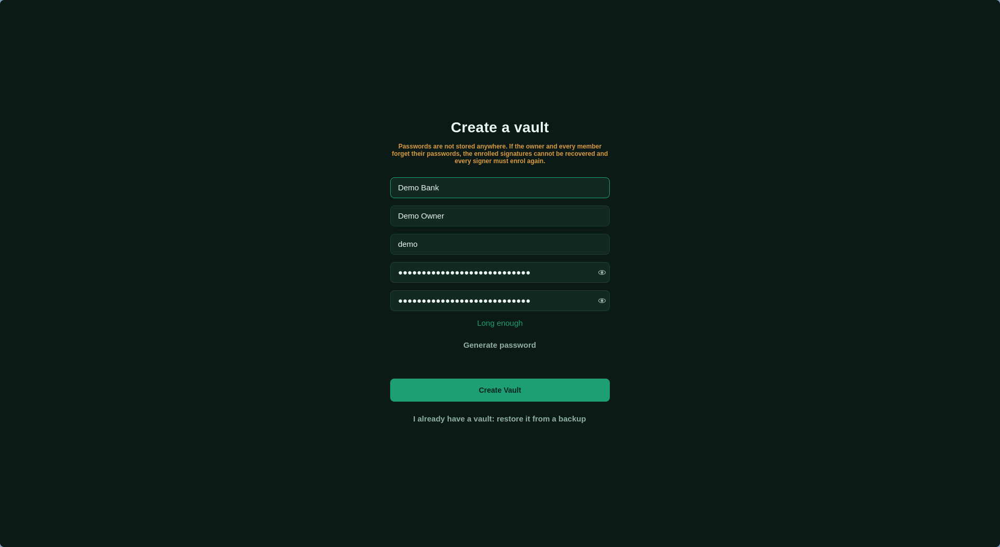
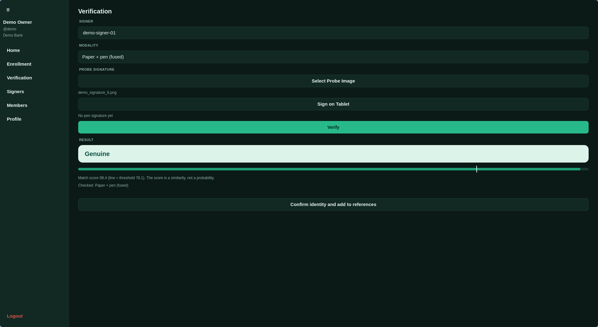
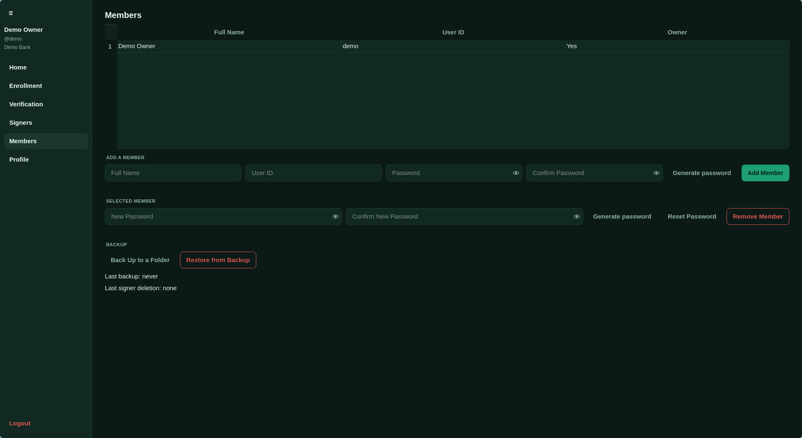

# Signature Verification System

[](https://www.python.org/)
[](https://pytorch.org/)
[](LICENSE)
[]()

> **Senior Design Project (EE 499)**, Department of Electrical and Computer Engineering, King Abdulaziz University (KAU), Jeddah, Saudi Arabia. Team 06.

SigVerify checks whether a signature is genuine or a skilled forgery, on your own computer. It reads a scan or photo of the paper signature, the pen movement recorded on a tablet, or both, and combines the two into one decision. Nothing leaves the machine.

---

## Contents

- [Architecture](#architecture)
- [Features](#features)
- [Project structure](#project-structure)
- [Getting started](#getting-started)
  - [Download and install](#download-and-install)
  - [Run from source](#run-from-source)
  - [What the app takes](#what-the-app-takes)
  - [GUI](#gui)
  - [Enrollment and decision](#enrollment-and-decision)
  - [Model weights](#model-weights)
- [Training](#training)
  - [Datasets and local directory layout](#datasets-and-local-directory-layout)
- [Evaluation](#evaluation)
  - [Accuracy of the whole system](#accuracy-of-the-whole-system)
  - [Each input on its own corpora](#each-input-on-its-own-corpora)
  - [Compared with published systems](#compared-with-published-systems)
- [Standards](#standards)
- [Hardware](#hardware)
- [References](#references)
- [Team](#team)
- [License](#license)
- [Acknowledgments](#acknowledgments)

---

## Architecture

```
┌─────────────────────────────────────────────────────────────┐
│                    Probe signature input                    │
│              (scan / tablet signature / both)               │
└──────────┬──────────────────────────────┬───────────────────┘
           │                              │
           ▼                              ▼
┌─────────────────────┐      ┌─────────────────────────┐
│   Spatial branch    │      │    Temporal branch      │
│   Siamese CNN       │      │    Siamese LSTM         │
│                     │      │                         │
│  [1, 1, 155, 220]   │      │  [1, L, 4] (X,Y,P,dt)   │
│       ↓             │      │       ↓                 │
│  512-d embedding    │      │  128-d embedding        │
│       ↓             │      │       ↓                 │
│  S_spatial          │      │  S_temporal             │
└──────────┬──────────┘      └──────────┬──────────────┘
           │                              │
           └──────────┬───────────────────┘
                      ▼
         ┌─────────────────────────┐
         │   Late fusion           │
         │                         │
         │  S = α·S_sp + (1-α)·S_t │
         │  S ≥ τ → Genuine        │
         │  S < τ → Forged         │
         └──────────┬──────────────┘
                    ▼
         [Genuine/Forged, match score vs τ]
```

With only one input, the app uses that branch alone ($\alpha = 1$ for a scan, $\alpha = 0$ for a tablet signature).

---

## Features

- **Two inputs, one decision.** A Siamese CNN reads the scan, a Siamese LSTM reads the pen movement, and late fusion combines their scores.
- **Five references, no retraining.** A new signer enrols with 5 signatures; each check is matched against the nearest of them.
- **Writer-independent.** One model for everyone, tested only on writers it never saw in training (ISO/IEC 23053:2022).
- **Fast on a normal CPU.** 0.52 s from pressing Enter to the fused result with 5 paper and 5 tablet references, 0.08 s per check against stored references, 0.35 GB of RAM (budget: 3 s and 4 GB). No GPU and no network.
- **Encrypted vaults.** Only embeddings are stored, never images or pen data, in an AES-256-GCM encrypted database unlocked by each member's password.
- **One download per system.** A Windows installer and a Linux AppImage (x86_64), no Python needed.

---

## Project structure

```
├── AGENTS.md                    # Rules and contracts for contributors and AI agents
├── DATASET_LICENSES.md          # Dataset licences and redistribution terms
├── LICENSE                      # MIT License
├── README.md
├── USER_GUIDE.md                # How to install and use the app
├── requirements.txt             # Development dependencies (training, tests)
├── requirements-app.txt         # What the installed app needs, nothing else
├── requirements-build.txt       # Installer build tool (PyInstaller)
├── pyproject.toml               # Makes the repo installable (pip install -e . --no-deps)
├── Signature_Verification_Pipeline.ipynb   # Pipeline demo notebook (outputs stripped)
├── config/
│   └── settings.py              # Every constant: paths, thresholds, hyperparameters
├── src/
│   ├── verification.py          # SignatureService: enrol, verify, fuse
│   ├── models/siamese.py        # SpatialSiamese (CNN), TemporalSiamese (LSTM), fusion
│   ├── data/                    # Preprocessing, input gates, dataset parsers
│   ├── database/db_manager.py   # Encrypted SQLite vault
│   ├── capture/                 # Tablet capture and the signing window
│   └── gui/                     # PyQt5 app (entry point: python -m src.gui.app)
├── bundle/                      # Installer build: PyInstaller recipe, --debug launcher, checks
├── scripts/                     # train.py, evaluate.py, benchmark.py
├── tools/                       # Latency profile, release reproduction, capture campaign
├── models/weights/              # .pth weights (from GitHub Releases)
├── results/                     # Figures written by code
└── tests/                       # Automated tests
```

---

## Getting started

### Download and install

Download the file for your system from the [Releases page](https://github.com/Rockeyxx/Signature-Verification-ML-EE499/releases). No Python is needed.

| System | File | How |
| --- | --- | --- |
| Windows 10/11, 64-bit | `SigVerify-vX.Y.Z-setup.exe` | Run it, then start SigVerify from the Start menu. No administrator password is needed. |
| Linux, 64-bit (tested on Arch) | `SigVerify-vX.Y.Z-x86_64.AppImage` | Mark it executable (`chmod +x`), then double-click it. |

- The Windows installer is not code-signed yet, so Windows may show "Windows protected your PC". Click **More info**, then **Run anyway**.
- Tablet on Windows: install the XPPen driver before enrolling anyone, and keep it. Linux needs no driver.
- Your data stays in the `.sigverify` folder in your home folder; updating or uninstalling the app does not touch it.

The [user guide](USER_GUIDE.md) covers first start, enrolment, verification, backup, error messages and uninstalling.

### Run from source

For development and training. Python 3.11 or newer.

```bash
git clone https://github.com/Rockeyxx/Signature-Verification-ML-EE499.git
cd Signature-Verification-ML-EE499

python -m venv .venv
source .venv/bin/activate        # Windows: .venv\Scripts\activate

# CPU torch from its own index first, then the rest
pip install torch torchvision --index-url https://download.pytorch.org/whl/cpu
pip install -r requirements.txt
pip install -e . --no-deps

python bundle/fetch_weights.py   # the two shipped weights, checked by SHA-256 (needs the gh CLI)
python -m src.gui.app
```

### What the app takes

| Input | At enrolment | At verification | Requirement |
| --- | --- | --- | --- |
| Paper signature | 5 photos or scans | 1 | Blue pen on white paper; the app crops to the ink and refuses a photo that is too small or too blurry |
| Tablet signature | 5 signings | 1 | XPPen Deco 640 (or a tablet meeting [Hardware](#hardware)); the same tablet model and operating system for enrolment and verification |

A signer can enrol with paper only, tablet only, or both. With both, each check uses paper, tablet or both, and both together is the most accurate.

### GUI

The first start opens **Create a vault**: one encrypted store with its own owner, members
and signers. Someone who already has a vault restores it from a backup there; later starts
open **Login**. **Home** shows your own and the vault's numbers and the recent checks.
**Enrollment** saves a signer from 5 paper photos, 5 tablet signings, or both.
**Verification** checks a claimed signer from a photo, a tablet signing, or both, and shows
Genuine or Forged with the match score against the threshold. **Signers** lists everyone
enrolled. **Profile** changes your name and password. **Members** (owner only) adds and
removes members, resets passwords, and makes or restores backups. Every password field has
a show/hide button, and new passwords can be generated. [USER_GUIDE.md](USER_GUIDE.md)
has the steps.

The screenshots come from the packaged app, with a made-up demo signer signed on a tablet.

| Create a vault | Login |
| :---: | :---: |
|  |  |
| **Home** | **Enrollment** |
|  |  |
| **Verification** | **Signers** |
|  |  |
| **Profile** | **Members** |
|  |  |

### Enrollment and decision

Verification compares a new signature with the signer's enrolled references:

| Parameter                 | Value                                                                | Configuration constant                                      |
| ------------------------- | -------------------------------------------------------------------- | ----------------------------------------------------------- |
| References per user ($K$) | **5**                                                                | `NUM_ENROLLMENT_REFERENCES = 5`                             |
| Matching rule             | Nearest reference: $d_{min} = \min_{i} \|e_{probe} - e_{ref, i}\|_2$ | `_nearest_reference_score`                                  |
| Similarity score          | $S = \frac{1}{1 + d_{min}}$                                          |                                                             |
| Decision threshold        | Paper alone $\tau = 0.8387$, tablet alone $\tau = 0.7900$            | `SPATIAL_DECISION_THRESHOLD`, `TEMPORAL_DECISION_THRESHOLD` |
| Fusion                    | $S = 0.4\,S_{spatial} + 0.6\,S_{temporal}$, fused $\tau = 0.7807$    | `ALPHA_DEFAULT`, `DECISION_THRESHOLD`                       |

The match score is a similarity, not a probability.

### Model weights

The installers already contain the weights. From source, `python bundle/fetch_weights.py` downloads `spatial_cnn.pth` and `temporal_lstm.pth` from the release named by `MODEL_VERSION` in `config/settings.py` and checks their SHA-256. What every file of a release is, and how it was measured, is in that release's notes on the [Releases page](https://github.com/Rockeyxx/Signature-Verification-ML-EE499/releases).

---

## Training

Train from scratch on one or more datasets, with writer-independent splits (70% train, 15% validation, 15% test):

```bash
# Spatial branch (scans)
python scripts/train.py --branch spatial \
    --data-dir data/cedar data/bhsig260 data/utsig \
    --epochs 100 --batch-size 32 --seed 42

# Temporal branch (pen trajectories)
python scripts/train.py --branch temporal --temporal-channels dt \
    --data-dir data/svc2004_task2 data/sigcomp2011 \
    --epochs 100 --batch-size 32 --seed 42
```

### Datasets and local directory layout

Put downloaded datasets in `./data`; the folder name selects the parser in `src/data/parsers.py`:

```
data/
├── cedar/                  # Scans, CEDAR (55 writers)
├── bhsig260/               # Scans, BHSig260 (260 writers): Bengali/, Hindi/
├── utsig/                  # Scans, UTSig (115 writers, Persian)
├── svc2004_task2/          # Pen, SVC2004 Task 2 (40 writers, with pressure)
├── sigcomp2011/            # Pen, SigComp2011 (Dutch and Chinese)
├── sigcomp2009_clean/      # Scan + pen pairs, SigComp2009 / NFI (evaluation only)
└── biosecurid_sonof/       # Scan + pen pairs, BiosecurID-SONOF (licensed, evaluation only)
```

Terms of use and how to obtain each dataset: [DATASET_LICENSES.md](DATASET_LICENSES.md).

---

## Evaluation

All numbers use the shipped weights on CPU, writers the weights never trained on, 5 enrolled references, and the references and the checked signature from the same sitting. EER is the error rate where false accepts equal false rejects; FAR and FRR are measured at the shipped threshold. Skilled forgeries are made by other people who practised the signature.

### Accuracy of the whole system

Paper and tablet recorded for the same people, scored as the app scores them:

| Collection | Writers | Paper alone EER | Tablet alone EER | **Fused EER** | Fused FAR / FRR at $\tau = 0.7807$ |
| --- | :-: | :-: | :-: | :-: | :-: |
| In-house, XPPen Deco 640 + phone and flatbed paper | 18 | 25.70% | 7.18% | **1.79%** | 2.78% / 1.60% |
| BiosecurID-SONOF (Wacom + scans) | 132 | 22.89% ± 0.48 | 6.11% ± 0.26 | **5.06% ± 0.20** | 2.53% / 10.17% |
| SigComp2009 / NFI | 14 | 22.79% ± 1.19 | 3.90% ± 1.11 | **3.40% ± 0.56** | 2.23% / 6.92% |

The in-house row is the deployment tablet: 18 writers, 125 genuine checks and 36 skilled forgeries, references are each writer's first 5 signings. The public rows are mean ± SD over 10 random draws of 5 references. $\alpha = 0.4$ was chosen on SONOF and $\tau$ at the in-house EER point; NFI took no part in either.

### Each input on its own corpora

Each branch alone, on the held-out test writers of its own training corpora (the split record shipped with each weight), mean ± SD over 10 draws of 5 references:

| Input | Corpus | Writers | EER | Pooled EER |
| --- | --- | :-: | :-: | :-: |
| Paper | CEDAR | 8 | 0.00% ± 0.00 | 0.00% |
| Paper | BHSig260 Hindi | 23 | 3.47% ± 0.90 | 3.34% |
| Paper | BHSig260 Bengali | 16 | 6.82% ± 1.10 | 6.89% |
| Paper | UTSig (Persian) | 18 | 26.34% ± 2.17 | 27.65% |
| **Paper** | **All four** | **65** | **7.46% ± 0.46** | **7.72%** |
| Tablet | SigComp2011 Dutch | 15 | 4.11% ± 1.03 | 4.18% |
| Tablet | SigComp2011 Chinese | 6 | 5.28% ± 0.85 | 5.23% |
| Tablet | SVC2004 Task 2 | 10 | 13.69% ± 2.25 | 14.92% |
| **Tablet** | **All three** | **31** | **7.79% ± 0.63** | **7.92%** |

Pooled EER puts every draw's scores together under one threshold.

### Compared with published systems

Where a published protocol can be matched:

| Dataset | Protocol (same on both sides) | Published EER | Source | This system |
| --- | --- | :-: | :-: | :-: |
| CEDAR (scan) | Writer-independent, 1 reference | 0.00% | [1] | 0.00% |
| BHSig260 Hindi (scan) | Writer-independent, 1 reference | 6.68% | [2] | 5.94% |
| BHSig260 Bengali (scan) | Writer-independent, 1 reference | 6.12% | [2] | 11.10% |
| UTSig (scan) | 5 references (published: a classifier fitted per writer) | 11.16% | [3] | 26.34% ± 2.17 |
| SVC2004 Task 2 (pen) | 5 references, skilled forgeries | 2.89% | [4] | 13.69% ± 2.25 |
| DeepSignDB (pen) | Official lists, 4 references, skilled forgeries | 2.54%, 2.44% | [5], [6] | 16.33% |

Published SVC2004 and DeepSignDB results use a threshold per writer or align the signatures in time; this system uses one global threshold. The only published fused result, on BiosecurID-SONOF [15], enrols from the first session and verifies on later sessions, so it is not in the same-sitting table: 4.91% there, 7.70% for this system under that protocol. Reproduce any release's numbers with `python tools/reproduce_release.py <tag>`.

---

## Standards

| Standard                 | What it covers here                                                       |    Status     |
| ------------------------ | ------------------------------------------------------------------------- | :-----------: |
| **ISO/IEC 23053:2022**   | Writer-independent splits, a split record shipped with every weight, reproducible training | **Met** |
| **IEEE 730-2014**        | Configuration control, deviation log, audit log of every verification and account change; no whole-system test yet (#43) | **Partial** |
| **ISO/IEC 24745:2022**   | Only embeddings stored, encrypted; re-enrolment when the model changes; no time-limited retention yet (#59) | **Partial** |
| **ISO/IEC 9075-1:2023**  | Relational SQLite schema: members, key slots, signers, enrolments, audit log | **Met** |
| **ISO/IEC 18033-1:2021** | AES-256-GCM encryption of the whole vault file, keys wrapped per member (scrypt) | **Met** |

---

## Hardware

Requirements on the tablet and its capture path:

| Specification       | Requirement                                                   | How the system handles it                                                                            |
| ------------------- | ------------------------------------------------------------- | ---------------------------------------------------------------------------------------------------- |
| **Report rate**     | $\ge 200\text{ Hz}$                                           | Resampled by timestamp onto a 10 ms grid (100 Hz model rate)                                         |
| **Timestamp**       | One timestamp per sample, monotonic                           | A wrapping counter is unwrapped and a burst sharing one timestamp is spread evenly before resampling |
| **Resolution**      | $\ge 2540\text{ LPI}$                                         | Coordinates normalised per signature (z-score)                                                       |
| **Pressure levels** | $\ge 1024$ levels, with the maximum reported by the driver    | Scaled to $[0, 1]$ by the reported maximum                                                           |
| **Device model**    | The same model for enrolment and verification                 | Not supported across models: on the same 65 people, references from one tablet scored another's probes at 13 to 42% EER |
| **Interface**       | USB HID                                                       | Qt tablet events: Windows (Wintab with the tablet driver, else Windows Ink), Linux                   |

---

## References

### Bibliography

#### Methods

1. S. Dey, A. Dutta, J. I. Toledo, S. K. Ghosh, J. Lladós, U. Pal. _SigNet: Convolutional Siamese Network for Writer Independent Offline Signature Verification._ arXiv:1707.02131, 2017.
2. F.-H. Huang, H.-M. Lu. _Multiscale Feature Learning Using Co-Tuplet Loss for Offline Handwritten Signature Verification._ arXiv:2308.00428, 2023.
3. O. Mersa, F. Etaati, S. Masoudnia, B. N. Araabi. _Learning Representations from Persian Handwriting for Offline Signature Verification, a Deep Transfer Learning Approach._ arXiv:1903.06249, 2019.
4. D.-Y. Yeung, H. Chang, Y. Xiong, S. George, R. Kashi, T. Matsumoto, G. Rigoll. _SVC2004: First International Signature Verification Competition._ ICBA 2004, LNCS 3072, pp. 16-22, 2004.
5. J. Jiang, S. Lai, L. Jin, Y. Zhu. _DsDTW: Local Representation Learning with Deep Soft-DTW for Dynamic Signature Verification._ IEEE Transactions on Information Forensics and Security 17:2198-2212, 2022.
6. R. Li, D. Yang. _Online Signature Verification Using Augmented Path Signature and T-Mamba._ arXiv:2609.08276, 2026.

#### Datasets

⚖ marks the references a dataset licence requires citing in any published work that uses that dataset: the four of DeepSignDB clause 4.5 and the one of BiosecurID-SONOF clause 4.4 (see [DATASET_LICENSES.md](DATASET_LICENSES.md)).

7. M. K. Kalera, S. Srihari, A. Xu. _Offline signature verification and identification using distance statistics._ IJPRAI 18(7):1339-1360, 2004. (CEDAR)
8. S. Pal, A. Alaei, U. Pal, M. Blumenstein. _Performance of an off-line signature verification method based on texture features on a large indic-script signature dataset._ DAS 2016, pp. 72-77, 2016. (BHSig260)
9. A. Soleimani, K. Fouladi, B. N. Araabi. _UTSig: A Persian offline signature dataset._ IET Biometrics 6(1):1-8, 2017. (UTSig)
10. M. Liwicki, M. I. Malik, C. E. van den Heuvel, X. Chen, C. Berger, R. Stoel, M. Blumenstein, B. Found. _Signature Verification Competition for Online and Offline Skilled Forgeries (SigComp2011)._ ICDAR 2011, pp. 1480-1484, 2011. (SigComp2011)
11. ⚖ R. Tolosana, R. Vera-Rodriguez, J. Fierrez, J. Ortega-Garcia. _DeepSign: Deep On-Line Signature Verification._ IEEE Transactions on Biometrics, Behavior, and Identity Science, 3(2):229-239, 2021. (DeepSignDB)
12. ⚖ J. Fierrez, J. Galbally, et al. _BiosecurID: A Multimodal Biometric Database._ Pattern Analysis and Applications, 13(2):235-246, 2010.
13. ⚖ J. Ortega-Garcia, J. Fierrez, et al. _The Multi-Scenario Multi-Environment BioSecure Multimodal Database (BMDB)._ IEEE TPAMI, 32(6):1097-1111, 2010.
14. ⚖ J. Ortega-Garcia, J. Fierrez, et al. _MCYT Baseline Corpus: A Bimodal Biometric Database._ IEE Proc. Vision, Image and Signal Processing, 150(6):395-401, 2003.
15. ⚖ J. Galbally, M. Diaz-Cabrera, M. A. Ferrer, M. Gomez-Barrero, A. Morales, J. Fierrez. _On-Line Signature Recognition Through the Combination of Real Dynamic Data and Synthetically Generated Static Data._ Pattern Recognition, 48:2921-2934, 2015. (BiosecurID-SONOF)

#### Standards

16. **ISO/IEC 23053:2022** Framework for Artificial Intelligence Systems Using Machine Learning.
17. **ISO/IEC 24745:2022** Information security, cybersecurity and privacy protection: Biometric information protection.
18. **ISO/IEC 9075-1:2023** Information technology, Database languages SQL, Part 1: Framework.
19. **ISO/IEC 18033-1:2021** Information security, Encryption algorithms, Part 1: General.
20. **IEEE 730-2014** IEEE Standard for Software Quality Assurance Processes.

---

## Team

**Team 06**, Senior Design Project, Department of Electrical and Computer Engineering, King Abdulaziz University.

---

## License

MIT License, see [LICENSE](LICENSE).

---

## Acknowledgments

- King Abdulaziz University, Faculty of Engineering, Department of Electrical and Computer Engineering.
- The authors of the CEDAR, BHSig260, UTSig, SVC2004, SigComp2011, SigComp2009, DeepSignDB and BiosecurID-SONOF datasets.
