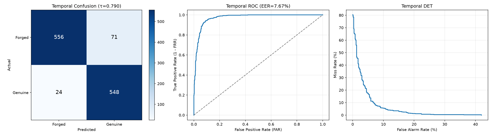
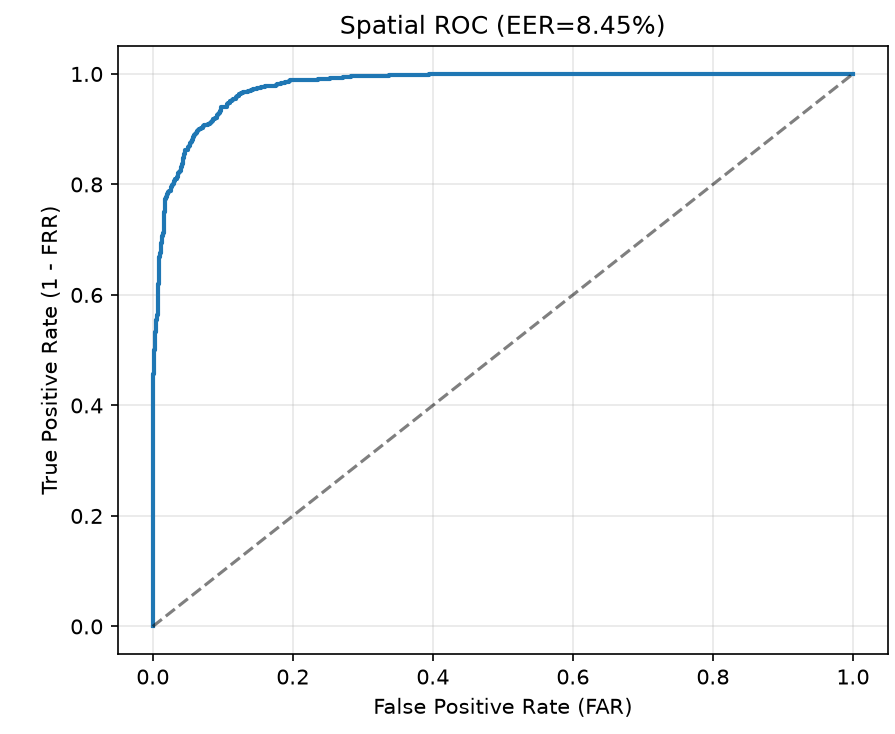

# Signature verification system

[](https://www.python.org/)
[](https://pytorch.org/)
[](LICENSE)
[]()

> Senior Design Project (EE 499), Department of Electrical and Computer
> Engineering, King Abdulaziz University (KAU), Jeddah, Saudi Arabia. Team 06.

Verifies handwritten signatures against skilled forgeries using two Siamese
networks: one reads a scanned image, the other reads the pen trajectory from a
tablet. Their scores are combined by late fusion.

This file covers installation, how to run it, and what it scores. Everything
else lives elsewhere:

| you want | read |
| --- | --- |
| how a number was measured, why a design choice was made, what failed | [SUMMARY.md](SUMMARY.md) |
| architecture contracts and constraints anyone changing the code must respect | [AGENTS.md](AGENTS.md) |
| dataset licences and redistribution terms | [DATASET_LICENSES.md](DATASET_LICENSES.md) |

---

## Install

```bash
git clone https://github.com/Rockeyxx/Signature-Verification-ML-EE499.git
cd Signature-Verification-ML-EE499

python -m venv venv
source venv/bin/activate        # Linux
# venv\Scripts\activate         # Windows

pip install -r requirements.txt
```

Python 3.10 or newer. Weights are not in the repository. Download
`spatial_cnn.pth` and `temporal_lstm.pth` from
[Releases](https://github.com/Rockeyxx/Signature-Verification-ML-EE499/releases)
and put them in `models/weights/`.

## Run

The desktop application is not built yet. `src/gui/` holds interface docstrings
and TODO markers, so `python -m src.gui.app` starts nothing. Until it exists,
run the system through the evaluation entry points.

```bash
# Score a branch on held-out writers under the enrollment protocol
python scripts/benchmark.py --branch temporal \
    --weights models/weights/temporal_lstm.pth --temporal-channels dt \
    --data-dir data/svc2004_task2 data/sigcomp2011 --enroll 5

# Regenerate the ROC, DET and confusion-matrix figures
python scripts/evaluate.py --branch spatial \
    --weights models/weights/spatial_cnn.pth \
    --data-dir data/cedar data/bhsig260 data/utsig --output-dir results

# Check the inference latency and memory budget
python tools/profile_latency.py --branch fused
```

Check your own signature images against the shipped spatial model:

```bash
python tools/verify_my_signature.py --crop \
    --references mine/ref1.jpg mine/ref2.jpg mine/ref3.jpg \
    --probes mine/genuine.jpg mine/forged.jpg
```

## Train

Datasets are not in the repository. Download them into `data/` first; terms and
sources are in [DATASET_LICENSES.md](DATASET_LICENSES.md).

```bash
# Spatial branch, offline images
python scripts/train.py --branch spatial \
    --data-dir data/cedar data/bhsig260 data/utsig \
    --epochs 100 --batch-size 32 --seed 42

# Temporal branch, both pen corpora together, from scratch
python scripts/train.py --branch temporal --temporal-channels dt \
    --data-dir data/svc2004_task2 data/sigcomp2011 \
    --epochs 100 --batch-size 32 --seed 42
```

`--temporal-channels` selects the capture width and must match the weights you
intend to score: `xyp` for 3 channels, `dt` for the 4 that ship, `tilt` for 5.

## What it scores

Shipped weights, open corpora only, `benchmark.py --enroll 5 --enroll-trials 10
--seed 42`. Each probe is matched against the nearest of 5 enrolled references.

Two statistics appear below and they are not interchangeable. **Mean ± sd** is
the EER of each of 10 independent reference draws, averaged; which 5 signatures
a user happens to enrol moves the result, so the spread is part of the answer.
**Pooled** is one EER over all draws at once, quoted where a single threshold is
needed. Mixing the two produced most of the wrong numbers in earlier versions of
this file.

| branch | dataset | writers | mean ± sd EER | pooled EER |
| --- | --- | :---: | --- | :---: |
| spatial | **all** | 65 | **8.59% ± 0.58** | 8.48% |
| spatial | cedar | 8 | 0.00% ± 0.00 | 0.00% |
| spatial | bhsig_Hindi | 23 | 3.64% ± 0.70 | 3.87% |
| spatial | bhsig_Bengali | 16 | 8.64% ± 1.35 | 8.55% |
| spatial | utsig | 18 | 30.26% ± 1.43 | 30.68% |
| temporal | **all** | 31 | **7.77% ± 0.67** | 7.67% |
| temporal | sigcomp_Dutch | 15 | 4.11% ± 1.03 | 4.18% |
| temporal | sigcomp_Chinese | 6 | 5.28% ± 0.85 | 5.23% |
| temporal | svc | 10 | 13.58% ± 2.21 | 14.00% |

The 5% design target is met on the pen-tablet tier, which SigComp Dutch stands
in for at 4.11%. It is not met pooled, and UTSig at 30% makes a pooled 5% claim
arithmetically impossible. UTSig is offline only, so fusion cannot rescue it.

Inference runs in 0.07 s warm and 0.94 s cold on CPU, inside 0.45 GB, against a
3.0 s and 4 GB budget.

### Best weights recorded

The lowest temporal error measured on this project came from adding DeepSignDB
Development's 498 stylus signers, which raised the training pool from 62 signers
to 311.

| temporal model | train signers | pooled EER | SigComp Dutch | SVC2004 |
| --- | :---: | :---: | :---: | :---: |
| DeepSignDB-trained, restricted | 311 | **7.57% ± 0.29%** | 3.54% ± 0.43% | 10.93% ± 1.23% |

Two things to keep straight about that row. It was measured on a different and
larger writer split than the shipped figures above, so it is not a like-for-like
comparison with the 7.77% in the table; adding a corpus reshuffles the split.
And repeating the experiment on top of the shipped `dt` model gave −0.13 points
at t = 0.28, so the gain does not survive there. The row records the measurement
that retired the "too few writers" hypothesis. See
[SUMMARY.md](SUMMARY.md) Part 9 §11.

These weights are not published. The DeepSignDB licence bars commercial use of
anything derived from the database, including files containing extracted
features (clause 4.4), and a public release would hand the file to anyone. The
published `temporal_lstm.pth` is trained only on SVC2004 and SigComp2011.

## Figures

Generated by `scripts/evaluate.py` from the shipped weights on open corpora. No
licensed data appears in any figure.

### Confusion matrices

Counts at the shipped fixed threshold, not at the EER balance point, so the
FAR/FRR pair here is a worse operating point than the EER above.

| spatial | temporal |
| --- | --- |
|  |  |

|  | true reject | false accept | true accept | false reject | FAR | FRR |
| --- | ---: | ---: | ---: | ---: | --- | --- |
| spatial | 1,376 | 94 | 1,155 | 134 | 6.39% | 10.40% |
| temporal | 564 | 63 | 540 | 32 | 10.05% | 5.59% |

The branches trade errors in opposite directions. Spatial turns genuine users
away more often than it lets forgeries through; temporal does the reverse.
Neither sits inside 5% FAR and 5% FRR at its shipped global threshold.

### ROC curves

| spatial | temporal |
| --- | --- |
|  |  |

ROC plots the true accept rate against the false accept rate as the threshold
sweeps. Area under the curve summarises separation independently of where the
threshold lands, which is why it is the standard curve to show. For a
verification system the DET curve is easier to read, because it plots FAR
against FRR on a normal-deviate scale and keeps the low-error corner legible
instead of compressing it. Those are written alongside as
`results/det_spatial.png` and `results/det_temporal.png`.

---

## References

### Methods

1. S. Dey, A. Dutta, J. I. Toledo, S. K. Ghosh, J. Lladós, U. Pal.
   _SigNet: Convolutional Siamese Network for Writer Independent Offline
   Signature Verification._ arXiv:1707.02131, 2017.
   <https://arxiv.org/abs/1707.02131>
2. L. G. Hafemann, R. Sabourin, L. S. Oliveira. _Learning features for offline
   handwritten signature verification using deep convolutional neural networks._
   Pattern Recognition 70:163-176, 2017. doi:10.1016/j.patcog.2017.05.012,
   preprint arXiv:1705.05787. Writer-ID training plus a per-user SVM, not a
   Siamese network; cited for its CEDAR/MCYT numbers, not as an architecture model.
3. O. Mersa, F. Etaati, S. Masoudnia, B. N. Araabi. _Learning Representations
   from Persian Handwriting for Offline Signature Verification, a Deep Transfer
   Learning Approach._ arXiv:1903.06249, 2019. <https://arxiv.org/abs/1903.06249>
4. A. Soleimani, B. N. Araabi, K. Fouladi. _Deep Multitask Metric Learning for
   Offline Signature Verification._ Pattern Recognition Letters 80:84-90, 2016.
5. A. Soleimani, K. Fouladi, B. N. Araabi. _UTSig: A Persian offline signature
   dataset._ IET Biometrics 6(1):1-8, 2017. Dataset paper and its own baseline.
6. D.-Y. Yeung, H. Chang, Y. Xiong, S. George, R. Kashi, T. Matsumoto, G. Rigoll.
   _SVC2004: First International Signature Verification Competition._ ICBA 2004,
   LNCS 3072, pp. 16-22. <https://cse.hkust.edu.hk/svc2004/icba2004paper.pdf>
7. C. Sekhar, P. Mukherjee, D. S. Guru, V. Pulabaigari. _OSVNet: Convolutional
   Siamese Network for Writer Independent Online Signature Verification._
   ICDAR 2019, arXiv:1904.00240. <https://arxiv.org/abs/1904.00240>
   The temporal branch's closest published Siamese counterpart.
8. M. Liwicki, M. I. Malik, C. E. van den Heuvel, X. Chen, C. Berger, R. Stoel,
   M. Blumenstein, B. Found. _Signature Verification Competition for Online and
   Offline Skilled Forgeries (SigComp2011)._ ICDAR 2011, pp. 1480-1484.
   doi:10.1109/ICDAR.2011.294
9. M. Antal, L. Z. Szabó, T. Tordai. _Online Signature Verification on MOBISIG
   Finger-Drawn Signature Corpus._ Mobile Information Systems, vol. 2018,
   Article ID 3127042. doi:10.1155/2018/3127042

### Datasets

10. M. K. Kalera, S. Srihari, A. Xu. _Offline signature verification and
    identification using distance statistics._ IJPRAI 18(7):1339-1360, 2004. CEDAR.
11. S. Pal, A. Alaei, U. Pal, M. Blumenstein. _Performance of an off-line
    signature verification method based on texture features on a large
    indic-script signature dataset._ DAS 2016, pp. 72-77. BHSig260.

The four below are required by the DeepSignDB licence (clause 4.5): any work
made public that rests directly or indirectly on any part of that database must
cite all four, whether or not the specific sub-corpus was used.

12. R. Tolosana, R. Vera-Rodriguez, J. Fierrez, J. Ortega-Garcia. _DeepSign:
    Deep On-Line Signature Verification._ IEEE Transactions on Biometrics,
    Behavior, and Identity Science, 3(2):229-239, 2021. DeepSignDB itself, and
    the source of the Development/Evaluation protocol this project follows.
13. J. Fierrez, J. Galbally, et al. _BiosecurID: A Multimodal Biometric
    Database._ Pattern Analysis and Applications, 13(2):235-246, May 2010.
14. J. Ortega-Garcia, J. Fierrez, et al. _The Multi-Scenario Multi-Environment
    BioSecure Multimodal Database (BMDB)._ IEEE Transactions on Pattern Analysis
    and Machine Intelligence, 32(6):1097-1111, 2010.
15. J. Ortega-Garcia, J. Fierrez, et al. _MCYT Baseline Corpus: A Bimodal
    Biometric Database._ IEE Proceedings, Vision, Image and Signal Processing,
    150(6):395-401, December 2003.

### Standards

16. ISO/IEC 23053:2022, framework for AI systems using machine learning
    (writer-independent splits, documented training configuration).
17. ISO/IEC 24745:2022, biometric information protection (only derived
    embeddings are persisted).
18. ISO/IEC 18033-1:2021, encryption algorithms (AES-256-GCM at rest).
19. IEEE 730-2014, software quality assurance processes (configuration control,
    deviation log, verification audit log).

A table comparing these published results against this project's numbers, with
the protocol differences that explain the gaps, is in
[SUMMARY.md](SUMMARY.md) Part 10.

---

## Team

Team 06, Department of Electrical and Computer Engineering, King Abdulaziz University.

## License

MIT. See [LICENSE](LICENSE).

## Acknowledgments

King Abdulaziz University, Faculty of Engineering, Department of Electrical and
Computer Engineering. The CEDAR, BHSig260, UTSig, SVC2004, SigComp2011 and
MOBISIG dataset authors are cited individually under References.
