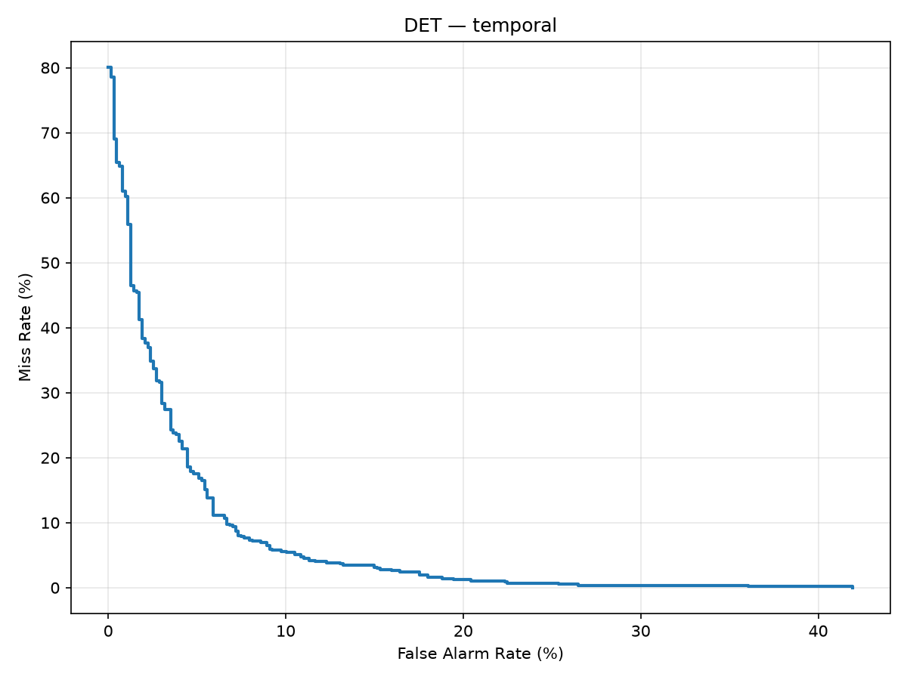

# Signature Verification System

[](https://www.python.org/)
[](https://pytorch.org/)
[](LICENSE)
[]()

> **Senior Design Project (EE 499)** — Department of Electrical and Computer Engineering, King Abdulaziz University (KAU), Jeddah, Saudi Arabia — Team 06

A multimodal biometric verification system that authenticates handwritten signatures using dual Siamese neural networks. Combines **offline** (image-based) and **online** (dynamic pen-trajectory) analysis through late fusion to deliver robust forgery detection.

---

## Contents

- [Architecture](#architecture)
- [Features](#features)
- [Project Structure](#project-structure)
- [Getting Started](#getting-started)
  - [Prerequisites](#prerequisites)
  - [Installation](#installation)
  - [Running the Application](#running-the-application)
  - [Input Specifications](#input-specifications)
  - [Model Weights & GitHub Releases](#model-weights-github-releases)
- [Training](#training)
  - [Datasets](#datasets)
- [Evaluation](#evaluation)
  - [Results](#results)
  - [Datasets and device targets](#datasets-and-device-targets)
  - [Evaluation Figures](#evaluation-figures)
- [Standards & Compliance](#standards-compliance)
- [Hardware](#hardware)
- [References](#references)
  - [Published results on the datasets this project uses](#published-results-on-the-datasets-this-project-uses)
  - [How the reference architecture differs](#how-the-reference-architecture-differs)
  - [Bibliography](#bibliography)
- [Team](#team)
- [License](#license)
- [Acknowledgments](#acknowledgments)

---

## Architecture

```
┌─────────────────────────────────────────────────────────────┐
│                    Probe Signature Input                     │
│              (Image / Dynamic / Both)                        │
└──────────┬──────────────────────────────┬────────────────────┘
           │                              │
           ▼                              ▼
┌─────────────────────┐      ┌─────────────────────────┐
│   Spatial Branch     │      │    Temporal Branch        │
│   Siamese CNN        │      │    Siamese LSTM           │
│                      │      │                           │
│  [1, 1, 155, 220]    │      │  [1, L, 3] (X, Y, P)     │
│       ↓              │      │       ↓                   │
│  512-d embedding     │      │  128-d embedding          │
│       ↓              │      │       ↓                   │
│  S_spatial           │      │  S_temporal               │
└──────────┬───────────┘      └──────────┬────────────────┘
           │                              │
           └──────────┬───────────────────┘
                      ▼
         ┌──────────────────────┐
         │   Late Fusion         │
         │                       │
         │  S = α·S_sp + (1-α)·S_t │
         │  S ≥ τ → Genuine      │
         │  S < τ → Forged       │
         └──────────┬────────────┘
                    ▼
         [Genuine/Forged, Confidence %]
```

**Automatic fallback:** if only one modality is available, the system routes to the corresponding unimodal branch (α = 1 for image-only, α = 0 for dynamic-only).

---

## Features

- **Dual-modality verification** — offline image analysis + online pen-trajectory analysis
- **Late-fusion scoring** — weighted combination with automatic unimodal fallback
- **Few-shot enrollment** — register users with one or more reference signatures, add more later
- **Encrypted storage** — AES-256-GCM encryption of embedding payloads at rest
- **Privacy by design** — only derived embeddings stored, never raw biometric data
- **Cross-platform** — runs on Windows and Linux with no native build steps
- **Desktop GUI** — PyQt5 application with enrollment and verification workflows
- **Audit logging** — every verification event recorded for offline QA
- **Device-agnostic capture** — abstract tablet interface with concrete driver implementations

---

## Project Structure

```
├── AGENTS.md                    # Contributor & AI agent rules
├── LICENSE
├── README.md
├── requirements.txt
├── config/
│   └── settings.py              # Hyperparameters, thresholds, paths
├── src/
│   ├── models/
│   │   └── siamese.py           # SpatialSiamese (CNN) + TemporalSiamese (LSTM)
│   │                            # + ContrastiveLoss + FusionEngine
│   ├── data/
│   │   └── dataset.py           # Data loading, preprocessing, quality gates
│   ├── database/
│   │   ├── db_manager.py        # SQLite schema, embedding storage, user management
│   │   └── encryption.py        # AES-256-GCM encryption + audit logging
│   ├── capture/
│   │   └── tablet.py            # Abstract tablet capture + platform drivers
│   └── gui/
│       ├── app.py               # Main application window
│       ├── enrollment.py        # Enrollment panel
│       └── verification.py      # Verification panel
├── scripts/
│   ├── train.py                 # Training entry point
│   └── evaluate.py              # Evaluation & calibration
└── tests/
    ├── test_models.py
    ├── test_database.py
    └── test_capture.py
```

---

## Getting Started

### Prerequisites

- Python 3.10+
- pip

### Installation

```bash
git clone https://github.com/Rockeyxx/Signature-Verification-ML-EE499.git
cd Signature-Verification-ML-EE499

python -m venv venv
source venv/bin/activate        # Linux
# venv\Scripts\activate         # Windows

pip install -r requirements.txt
```

### Running the Application

```bash
python -m src.gui.app
```

---

### Input Specifications

- **Spatial (offline):** any image format (JPG, PNG, etc.); app resizes to 155×220, inverts, normalizes internally.
- **Temporal (online):** trajectory at 100 Hz with X, Y, Pressure channels; app z-scores X/Y per signature and scales pressure to [0.0, 1.0].

Both are enforced at the door. A photo that is too small or too blurry, or a
trajectory that was not normalized by the capture layer, is **rejected rather
than scored** — a wrong answer given confidently is worse than no answer. The
full contract the capture layer must satisfy is in
[AGENTS.md](AGENTS.md#capture-contract-for-the-capture-and-gui-layers).

#### Enrollment and decision

|                     | value                                       | constant                                                     |
| ------------------- | ------------------------------------------- | ------------------------------------------------------------ |
| References per user | **5**                                       | `NUM_ENROLLMENT_REFERENCES = 5`                              |
| Matching            | nearest reference, not the mean             | `_nearest_reference_score`                                   |
| Score               | `S = 1 / (1 + distance)`                    |                                                              |
| Threshold           | spatial `τ = 0.6299`, temporal `τ = 0.8524` | `SPATIAL_DECISION_THRESHOLD` / `TEMPORAL_DECISION_THRESHOLD` |

Enrolling fewer than 5 references drops the system into the pair-scoring regime,
which is a few EER points worse — see [Evaluation Figures](#evaluation-figures).

---

### Model Weights & GitHub Releases

Compiled PyTorch model weights (`.pth` checkpoint files) are strictly excluded from Git repository tracking via `.gitignore` to keep the repository lightweight:

- **Pre-compiled Weights Distribution**: Official pre-trained weights (`spatial_cnn.pth` and `temporal_lstm.pth`) are hosted and distributed via **[GitHub Releases](https://github.com/Rockeyxx/Signature-Verification-ML-EE499/releases)**.
- **Local Deployment**: Download the compiled weight `.pth` files from the latest GitHub Release and place them into the `models/weights/` directory:
  ```
  models/weights/
  ├── spatial_cnn.pth
  └── temporal_lstm.pth
  ```

**Weights trained on DeepSignDB are not published here.** The licence bars commercial
use of anything derived from the database, including "files containing extracted
features" (clause 4.4), and a public release makes the file available to anyone,
commercial users included. The published `temporal_lstm.pth` is trained on the
openly available corpora (SVC2004 + SigComp2011), while DeepSignDB-trained weights
stay local and are used for the project report, demo and benchmarks.

---

## Training

```bash
# Train spatial branch (offline signatures)
python scripts/train.py --branch spatial --data-dir ./data/cedar ./data/bhsig260 ./data/utsig

# Train temporal branch (online signatures)
python scripts/train.py --branch temporal --data-dir ./data/svc2004
```

Training uses **writer-independent splits** — see
[Results](#results).

---

### Datasets

#### Local Dataset Structure (`./data`)

To train and evaluate the models locally, arrange your datasets inside the `./data` directory following this layout:

```
data/
├── cedar/                  # Offline CEDAR dataset (55 writers)
│   ├── writer_01/
│   │   ├── original_1_1.png ... original_1_24.png  (Genuine signatures)
│   │   └── forged_1_1.png   ... forged_1_24.png    (Skilled Forgeries)
│   └── ...
├── bhsig260/               # Offline BHSig260 dataset (260 writers)
│   ├── Bengali/
│   └── Hindi/
├── utsig/                  # Offline UTSig dataset (115 writers)
├── svc2004_task1/          # Online SVC2004 Task1 (40 writers, 4-col, no pressure)
│   └── U1S1.TXT ... U40S40.TXT
├── svc2004_task2/          # Online SVC2004 Task2 (40 writers, 7-col, real pressure)
│   └── U1S1.TXT ... U40S40.TXT
├── MOBISIG/                # Online MOBISIG (83 users) — mobile/iPad proxy
│   ├── USER1/
│   │   ├── SIGN_GEN_USER1_USER1_1.csv   (45 genuine)
│   │   └── SIGN_FOR_USER1_USER2_1.csv   (20 skilled forgeries)
│   └── ...
├── sigcomp2011/            # Online SigComp2011 (84 pen-tablet writers, 3695 signatures)
│   ├── trainingSet/OnlineSignatures/{Dutch,Chinese}/TrainingSet/
│   │   ├── Online Genuine/     001_01.HWR       (writer_index)
│   │   └── Online Forgeries/   170_001_02.HWR   (forger_writer_index)
│   └── Testdata_SigComp2011/SigComp11-Onlinetestset/{Dutch,Chinese}/
│       ├── Reference(648)/013/   13_013.HWR     (index_writer — reversed!)
│       └── Questioned(1259)/013/ 01_182_013.HWR (index_forger_writer)
└── deepsigndb/             # Online DeepSignDB — SIGNED LICENCE REQUIRED, see below
    ├── DeepSignDB/
    │   ├── Development/{stylus,finger}/  u0001_g_0100v00.txt  (genuine)
    │   │                                 u0001_s_0100v00.txt  (skilled forgery)
    │   └── Evaluation/{stylus,finger}/   the authors' held-out benchmark
    └── Comparison_Files/TBIOM_2021_Journal/   official protocol lists + README.pdf
```

Directory names are how parsers are selected (`src/data/parsers.py`), so an
unrecognized name raises rather than silently training on zero writers.

SigComp2011 downloads openly; DeepSignDB and most other large corpora require a
signed licence agreement.

---

## Evaluation

```bash
# Evaluate a single branch
python scripts/evaluate.py --branch spatial \
    --weights ./models/weights/spatial_cnn.pth \
    --data-dir ./data/cedar --output-dir ./results

# α grid search + tri-point report (fusion weight calibration)
python scripts/evaluate.py --branch fused --alpha-sweep \
    --spatial-weights ./models/weights/spatial_cnn.pth \
    --temporal-weights ./models/weights/temporal_lstm.pth \
    --data-dir ./data --output-dir ./results
```

Metrics reported:

- **EER** (Equal Error Rate) per branch and fused
- **FAR / FRR** under skilled-forgery protocol
- **ROC / DET curves** and confusion matrices
- **α-vs-EER sweep** plot for fusion weight selection

---

### Results

| dataset                 | this system       | published Siamese (Dey et al.) |
| ----------------------- | ----------------- | ------------------------------ |
| cedar (Latin)           | **0.00% ± 0.00**  | 0.00%                          |
| bhsig_Hindi             | **3.64% ± 0.70**  | 15.36%                         |
| bhsig_Bengali           | **8.64% ± 1.35**  | 13.89%                         |
| utsig (Persian)         | 30.26% ± 1.43     | not evaluated                  |
| **pooled (65 writers)** | **8.59% ± 0.58**  | —                              |

Retraining this same configuration with a different seed gives 9.27%, so read the
pooled figure as roughly **8.6 to 9.3%**. Differences under about one point are
not resolvable from a single training run.

### Datasets and device targets

| Dataset     | Modality | Script           | Role                                      |
| ----------- | -------- | ---------------- | ----------------------------------------- |
| CEDAR       | Offline  | Latin            | Spatial branch training                   |
| BHSig260    | Offline  | Bengali / Hindi  | Multi-script generalization               |
| UTSig       | Offline  | Persian / Arabic | Closest proxy to Arabic-script deployment |
| SVC2004     | Online   | —                | Pen-tablet proxy                          |
| SigComp2011 | Online   | Dutch / Chinese  | Pen-tablet volume (84 writers)            |
| MOBISIG     | Online   | —                | Mobile / iPad proxy                       |

Device support is **tiered**. The primary target is the **XPPen Deco 640 pen
tablet**, which must reach the 5% FAR/FRR spec — and does, at **FAR 1.80% /
FRR 7.05%** on the matching pen-tablet dataset. Mobile and iPad capture is a
secondary path where roughly 80% accuracy is acceptable, because a finger on a
capacitive touchscreen reports contact area rather than true pen pressure. The
temporal branch is trained on the two pen datasets together, from scratch.

### Evaluation Figures

From the shipped weights on the open corpora only — no licensed data appears in
any figure. Scored the way the app scores: each probe matched against the nearest
of 5 enrolled references.

|                                    | spatial        | temporal                |
| ---------------------------------- | -------------- | ----------------------- |
| EER                                | 10.08%         | 10.35%                  |
| FAR / FRR at the shipped threshold | 9.25% / 11.17% | 7.97% / 14.51%          |
| best dataset                       | cedar 0.00%    | **sigcomp_Dutch 4.02%** |
| worst dataset                      | utsig 30.68%   | svc 18.00%              |

The thresholds are set to hold **false accepts at or under 10%**, because letting
a forgery through is worse than asking a real user to sign again. Pushing false
accepts below 5% is possible but turns away more than one genuine user in five,
so it is not the shipped setting. On **SigComp Dutch — the pen-tablet condition
matching the XPPen** — the system runs at FAR 1.80% / FRR 7.05%, inside the 5%
target.

#### Confusion matrices

Counts at the calibrated threshold, over held-out test writers.

| spatial                                                            | temporal                                                             |
| ------------------------------------------------------------------ | -------------------------------------------------------------------- |
|  |  |

The spatial matrix reads 13,921 true rejects and 1,967 false accepts against
13,481 true accepts and 2,407 false rejects. The two error types are close in
size, which is the intended calibration — earlier weights sat at FAR 10.12%
against FRR 21.20%, roughly double, and AGENTS.md requires slack to land on FRR
only once FAR is already held down.

#### ROC and DET curves

DET is the curve to read for a verification system: it plots FAR against FRR on a
normal-deviate scale, so the operating point and the shape of the trade-off are
both visible, where ROC compresses the region that matters into the top-left corner.

|         | spatial                                               | temporal                                                |
| ------- | ----------------------------------------------------- | ------------------------------------------------------- |
| **ROC** |  |  |
| **DET** |  |  |

Reproduce any of these with:

```bash
python scripts/evaluate.py --branch spatial --weights models/weights/spatial_cnn.pth \
    --data-dir ./data/cedar ./data/bhsig260 ./data/utsig --output-dir results --seed 42

python scripts/evaluate.py --branch temporal --weights models/weights/temporal_lstm.pth \
    --data-dir ./data/svc2004_task2 ./data/sigcomp2011 --output-dir results --seed 42
```

---

## Standards & Compliance

| Standard             | Application in This Project                                       |
| -------------------- | ----------------------------------------------------------------- |
| IEEE 730             | Configuration control, deviation log, verification audit log      |
| ISO/IEC 23053:2022   | Writer-independent data splits, documented training configuration |
| ISO/IEC 24745:2022   | Only derived embeddings persisted — never raw biometric data      |
| ISO/IEC 9075-1:2023  | Structured relational SQLite schema                               |
| ISO/IEC 18033-1:2021 | AES-256-GCM encryption of stored embedding payloads               |

---

## Hardware

The capture layer uses an **abstract tablet interface** that supports any digitizer tablet. The reference implementation targets:

| Spec            | Value      |
| --------------- | ---------- |
| Report rate     | ≥ 200 Hz   |
| Resolution      | ≥ 2540 LPI |
| Pressure levels | ≥ 1024     |
| Connection      | USB        |

**Platform capture paths:**

- **Windows:** Wintab API
- **Linux:** evdev / OpenTabletDriver

---

## References

The published figures this project is measured against, with the protocol each
one used. Every "this project" number comes from `benchmark.py --enroll 5`: mean
over 10 draws, seed 42, held-out writers only.

### Published results on the datasets this project uses

The **This project** column mirrors the shipped column of the results table
above — it is not a separate measurement. Update both together.

| Dataset                     | Published                   | Protocol                                                | Source | This project      |
| --------------------------- | --------------------------- | ------------------------------------------------------- | ------ | ----------------- |
| CEDAR                       | **0.00%** EER (100.00% acc) | WI Siamese CNN, 50 of 55 writers trained                | [1]    | **0.00% ± 0.00**  |
| CEDAR                       | 4.63% EER                   | WD SVM on CNN features, K = 12                          | [2]    | **0.00% ± 0.00**  |
| BHSig260 Bengali            | **13.89%** EER (86.11% acc) | WI Siamese CNN, 50 of 100 writers trained               | [1]    | **12.07% ± 1.38** |
| BHSig260 Hindi              | 15.36% EER (84.64% acc)     | WI Siamese CNN, 100 of 160 writers trained              | [1]    | **4.30% ± 0.78**  |
| UTSig                       | **9.80%** EER               | WD SVM, transfer from Persian handwriting, K = 10       | [3]    | 30.74% ± 1.78     |
| UTSig                       | 11.16% EER                  | same, K = 5 — the closest protocol match to ours        | [3]    | 30.74% ± 1.78     |
| UTSig                       | 17.45% EER                  | WD DMML on HOG features, K = 12                         | [4]    | 30.74% ± 1.78     |
| UTSig                       | 29.71% EER                  | WD SVM on fixed-point geometrics, K = 12                | [5]    | 30.74% ± 1.78     |
| SVC2004 Task 2              | **2.89%** EER               | competition winner of 8 teams, K = 5, skilled forgeries | [6]    | 17.46% ± 1.99     |
| SVC2004 Task 2              | 77.00% acc                  | WI Siamese CNN, 35 writers trained / 5 tested           | [7]    | 17.46% ± 1.99     |
| SigComp2011 online, Dutch   | not established here        | competition, reference-set matching                     | [8]    | **4.19% ± 0.75**  |
| SigComp2011 online, Chinese | not established here        | competition, reference-set matching                     | [8]    | 8.11% ± 1.76      |
| MOBISIG                     | 5.81% EER                   | DTW, a posteriori **user-specific** thresholds          | [9]    | 21.26%            |
| MOBISIG                     | 14.31% EER                  | global features, **global** threshold                   | [9]    | 21.26%            |

Two datasets carry a real gap: UTSig and SVC2004. Both have a known cause. Every
published UTSig result is writer-dependent with 10 to 12 references. SVC2004's
contributors were told not to use their real signatures, and its forgers watched
the signing process on a monitor and were allowed to practise, which is why one
temporal model scores 17.46% there and 4.19% on SigComp2011's Dutch pen writers.

Reference [8] reports the SigComp2011 online results per system. Those figures
are left out here because the tables circulating in secondary sources could not
be confirmed as the online task rather than the offline one, and quoting the
wrong one would compare this project against a different measurement.

### How the reference architecture differs

The spatial branch is measured against [1], which is the same architecture class
(Siamese CNN, contrastive loss, margin 1). Its configuration, from the paper's
own tables:

|                  | Dey et al. SigNet [1]                  | this project                                                              |
| ---------------- | -------------------------------------- | ------------------------------------------------------------------------- |
| input            | 155×220, inverted, ÷ std               | 155×220, inverted, ÷ 255                                                  |
| pairs per writer | 276 genuine + 276 forged               | 276 + 276                                                                 |
| conv stack       | 96×11×11 → 256×5×5 → 384×3×3 → 256×3×3 | 32×5×5 → 64 → 128 → 256 → 256 (their stack is selectable, measured below) |
| normalization    | local response norm                    | GroupNorm                                                                 |
| head             | FC-1024 (dropout 0.5) → FC-128         | 4×4 avg+max pool (8192) → FC-512                                          |
| dropout          | 0.3 after pools 2 and 4, 0.5 after FC1 | none                                                                      |
| optimizer        | RMSprop 1e-4, momentum 0.9, wd 5e-4    | Adam 1e-3, wd 1e-4                                                        |
| batch / epochs   | 128 / 20                               | 32 / early-stopped                                                        |
| loss             | contrastive, margin 1                  | contrastive, margin 1 + hard-negative mining                              |

The reference trunk was measured against ours as three separate arms, and only
the first paid off: the wide stack alone reached 11.78% pooled EER against the
compact stack's 12.31% (UTSig −3.35), while adding their dropout schedule cost
6.78 points and adding their FC-1024 head on top of it collapsed the model
outright. At 301 training writers the failure mode is data scarcity rather than
excess capacity, so the regularization Dey et al. need at GPDS300 scale removes
capacity this project cannot spare. The wide stack ships; its dropout schedule and
FC-1024 head do not.

### Bibliography

**Methods**

1. S. Dey, A. Dutta, J. I. Toledo, S. K. Ghosh, J. Lladós, U. Pal.
   _SigNet: Convolutional Siamese Network for Writer Independent Offline
   Signature Verification._ arXiv:1707.02131, 2017.
   <https://arxiv.org/abs/1707.02131>
2. L. G. Hafemann, R. Sabourin, L. S. Oliveira. _Learning features for offline
   handwritten signature verification using deep convolutional neural networks._
   Pattern Recognition 70:163–176, 2017. doi:10.1016/j.patcog.2017.05.012 —
   preprint arXiv:1705.05787. Writer-ID training plus a per-user SVM, **not** a
   Siamese network; cited for its CEDAR/MCYT numbers, not as an architecture model.
3. O. Mersa, F. Etaati, S. Masoudnia, B. N. Araabi. _Learning Representations
   from Persian Handwriting for Offline Signature Verification, a Deep Transfer
   Learning Approach._ arXiv:1903.06249, 2019. <https://arxiv.org/abs/1903.06249>
4. A. Soleimani, B. N. Araabi, K. Fouladi. _Deep Multitask Metric Learning for
   Offline Signature Verification._ Pattern Recognition Letters 80:84–90, 2016.
5. A. Soleimani, K. Fouladi, B. N. Araabi. _UTSig: A Persian offline signature
   dataset._ IET Biometrics 6(1):1–8, 2017. Dataset paper and its own baseline.
6. D.-Y. Yeung, H. Chang, Y. Xiong, S. George, R. Kashi, T. Matsumoto, G. Rigoll.
   _SVC2004: First International Signature Verification Competition._ ICBA 2004,
   LNCS 3072, pp. 16–22. <https://cse.hkust.edu.hk/svc2004/icba2004paper.pdf>
7. C. Sekhar, P. Mukherjee, D. S. Guru, V. Pulabaigari. _OSVNet: Convolutional
   Siamese Network for Writer Independent Online Signature Verification._
   ICDAR 2019 — arXiv:1904.00240. <https://arxiv.org/abs/1904.00240>
   The temporal branch's closest published Siamese counterpart.
8. M. Liwicki, M. I. Malik, C. E. van den Heuvel, X. Chen, C. Berger, R. Stoel,
   M. Blumenstein, B. Found. _Signature Verification Competition for Online and
   Offline Skilled Forgeries (SigComp2011)._ ICDAR 2011, pp. 1480–1484.
   doi:10.1109/ICDAR.2011.294
9. M. Antal, L. Z. Szabó, T. Tordai. _Online Signature Verification on MOBISIG
   Finger-Drawn Signature Corpus._ Mobile Information Systems, vol. 2018,
   Article ID 3127042. doi:10.1155/2018/3127042

**Datasets**

10. M. K. Kalera, S. Srihari, A. Xu. _Offline signature verification and
    identification using distance statistics._ IJPRAI 18(7):1339–1360, 2004. — CEDAR.
11. S. Pal, A. Alaei, U. Pal, M. Blumenstein. _Performance of an off-line
    signature verification method based on texture features on a large
    indic-script signature dataset._ DAS 2016, pp. 72–77. — BHSig260.

The four below are **required by the DeepSignDB licence** (clause 4.5): any work
made public that rests directly or indirectly on any part of that database must
cite all four, whether or not the specific sub-corpus was used.

12. R. Tolosana, R. Vera-Rodriguez, J. Fierrez, J. Ortega-Garcia. _DeepSign:
    Deep On-Line Signature Verification._ IEEE Transactions on Biometrics,
    Behavior, and Identity Science, 3(2):229–239, 2021. — DeepSignDB itself, and
    the source of the Development/Evaluation protocol this project follows.
13. J. Fierrez, J. Galbally, et al. _BiosecurID: A Multimodal Biometric
    Database._ Pattern Analysis and Applications, 13(2):235–246, May 2010.
14. J. Ortega-Garcia, J. Fierrez, et al. _The Multi-Scenario Multi-Environment
    BioSecure Multimodal Database (BMDB)._ IEEE Transactions on Pattern Analysis
    and Machine Intelligence, 32(6):1097–1111, 2010.
15. J. Ortega-Garcia, J. Fierrez, et al. _MCYT Baseline Corpus: A Bimodal
    Biometric Database._ IEE Proceedings — Vision, Image and Signal Processing,
    150(6):395–401, December 2003.

**Standards**

16. ISO/IEC 23053:2022 — framework for AI systems using machine learning
    (writer-independent splits, documented training configuration).
17. ISO/IEC 24745:2022 — biometric information protection (only derived
    embeddings are persisted).
18. ISO/IEC 18033-1:2021 — encryption algorithms (AES-256-GCM at rest).
19. IEEE 730-2014 — software quality assurance processes (configuration control,
    deviation log, verification audit log).

---

## Team

**Team 06** — Department of Electrical and Computer Engineering, King Abdulaziz University

---

## License

This project is licensed under the MIT License — see [LICENSE](LICENSE) for details.

---

## Acknowledgments

- King Abdulaziz University, Faculty of Engineering, Department of Electrical and Computer Engineering
- The CEDAR, BHSig260, UTSig, SVC2004, SigComp2011 and MOBISIG dataset authors —
  cited individually under [References](#references)
