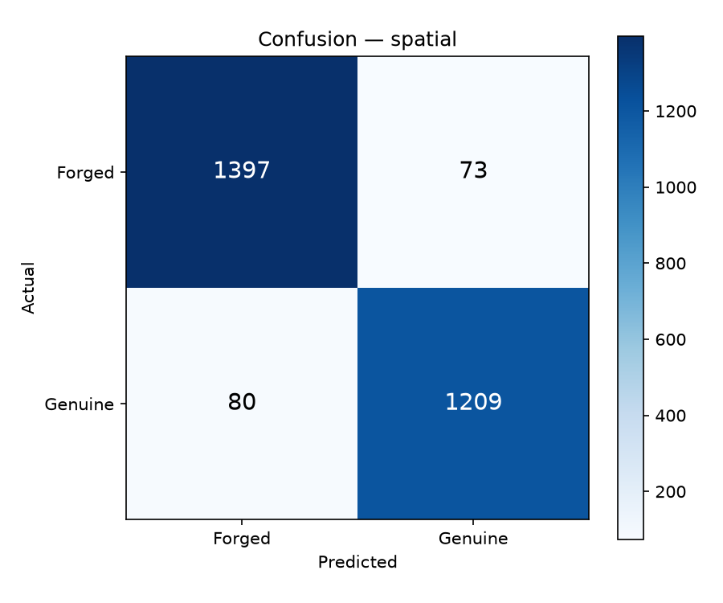
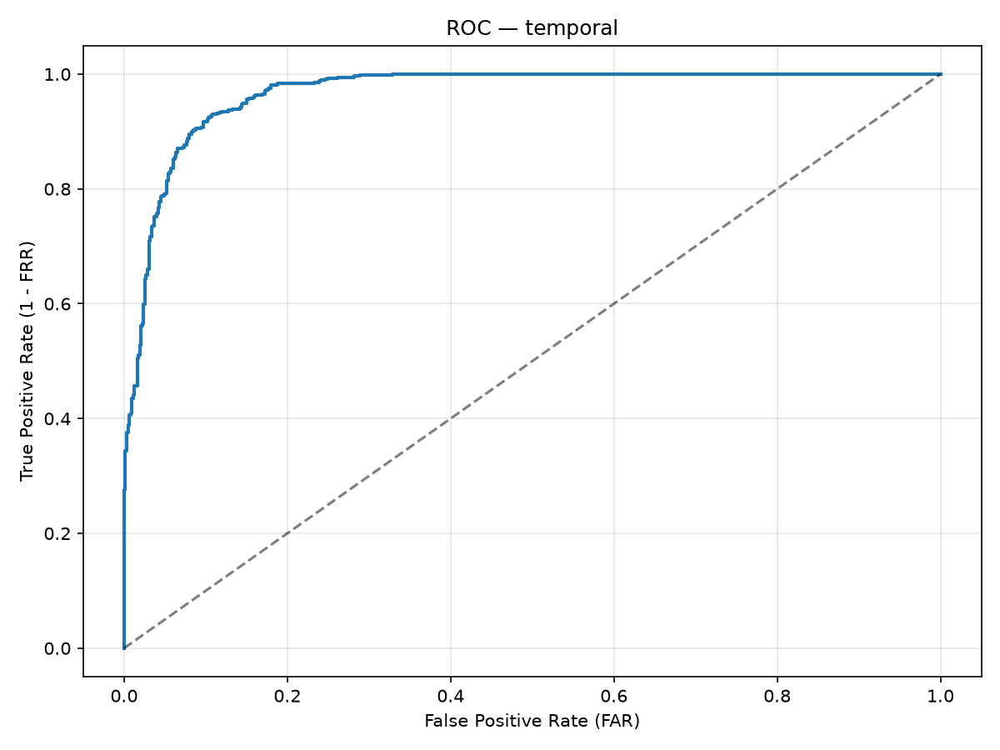

# Signature Verification System

[](https://www.python.org/)
[](https://pytorch.org/)
[](LICENSE)
[]()

> **Senior Design Project (EE 499)** — Department of Electrical and Computer Engineering, King Abdulaziz University (KAU), Jeddah, Saudi Arabia — Team 06

A multimodal signature verification system built with dual Siamese deep neural networks. It verifies signatures using both **offline** (scanned images) and **online** (dynamic tablet pen strokes) inputs, combining their scores via late fusion to detect genuine signatures and skilled forgeries.

---

## Contents

- [Architecture](#architecture)
- [Features](#features)
- [Project Structure](#project-structure)
- [Getting Started](#getting-started)
  - [Prerequisites](#prerequisites)
  - [Installation](#installation)
  - [Running the Application](#running-the-application)
  - [Input Specifications](#input-specifications)
  - [Model Weights & GitHub Releases](#model-weights--github-releases)
- [Training](#training)
  - [Datasets](#datasets)
- [Evaluation](#evaluation)
  - [Results](#results)
  - [Datasets and device targets](#datasets-and-device-targets)
  - [Evaluation Figures](#evaluation-figures)
- [Standards & Compliance](#standards--compliance)
- [Hardware](#hardware)
- [References](#references)
  - [Published results on the datasets this project uses](#published-results-on-the-datasets-this-project-uses)
  - [How the reference architecture differs](#how-the-reference-architecture-differs)
  - [Bibliography](#bibliography)
- [Team](#team)
- [License](#license)
- [Acknowledgments](#acknowledgments)

---

## Architecture

```
┌─────────────────────────────────────────────────────────────┐
│                    Probe Signature Input                     │
│              (Image / Dynamic / Both)                        │
└──────────┬──────────────────────────────┬────────────────────┘
           │                              │
           ▼                              ▼
┌─────────────────────┐      ┌─────────────────────────┐
│   Spatial Branch     │      │    Temporal Branch        │
│   Siamese CNN        │      │    Siamese LSTM           │
│                      │      │                           │
│  [1, 1, 155, 220]    │      │  [1, L, 4] (X,Y,P,dt)    │
│       ↓              │      │       ↓                   │
│  512-d embedding     │      │  128-d embedding          │
│       ↓              │      │       ↓                   │
│  S_spatial           │      │  S_temporal               │
└──────────┬───────────┘      └──────────┬────────────────┘
           │                              │
           └──────────┬───────────────────┘
                      ▼
         ┌──────────────────────┐
         │   Late Fusion         │
         │                       │
         │  S = α·S_sp + (1-α)·S_t │
         │  S ≥ τ → Genuine      │
         │  S < τ → Forged       │
         └──────────┬────────────┘
                    ▼
         [Genuine/Forged, Confidence %]
```

**Single-Modality Fallback:** When only one input modality is provided, the system automatically routes to that branch ($\alpha = 1$ for spatial images, $\alpha = 0$ for temporal trajectories).

---

## Features

**Implemented and measured** — the model and evaluation pipeline:

- **Dual-Modality Pipeline** — Combines static image analysis with dynamic pen stroke trajectory modeling
- **Late-Fusion Engine** — Weighted score fusion with automatic single-modality fallback (`src/models/siamese.py`)
- **Few-Shot Enrollment Scoring** — Probes matched against the nearest of K=5 stored reference embeddings (`src/verification.py`)
- **Writer-Independent Evaluation** — Held-out-writer benchmarking, EER / FAR / FRR / DET (`scripts/benchmark.py`, `scripts/evaluate.py`)
- **Cross-Platform** — Runs natively on Windows and Linux with standard prebuilt Python packages

**Specified, not yet built** — the application layer is currently interface
docstrings and `TODO` markers, with no implementation behind them:

- **PyQt5 Desktop Interface** (`src/gui/`) — enrollment and verification panels
- **Digitizer Tablet Layer** (`src/capture/`) — Wintab / evdev drivers for digitizer pads such as the XPPen Deco 640
- **Encrypted Template Store** (`src/database/`) — SQLite schema, AES-256-GCM embedding encryption, audit log

Everything under [Evaluation](#evaluation) is measured from the ML pipeline
directly. No number in this README depends on the unbuilt application layer.


---

## Project Structure

```
├── AGENTS.md                    # Contributor & AI agent rules
├── SUMMARY.md                   # End-to-end walkthrough + negative-results ledger
├── DATASET_LICENSES.md          # Per-corpus licence terms and redistribution limits
├── LICENSE
├── README.md
├── requirements.txt
├── Signature_Verification_Pipeline.ipynb   # Imports scripts/; adds no logic of its own
├── config/
│   └── settings.py              # Hyperparameters, thresholds, paths
├── src/
│   ├── verification.py          # Enrollment scoring + capture-contract gate
│   ├── models/
│   │   └── siamese.py           # SpatialSiamese (CNN) + TemporalSiamese (LSTM)
│   │                            # + ContrastiveLoss + FusionEngine
│   ├── data/
│   │   ├── dataset.py           # Pair construction, preprocessing, quality gates
│   │   ├── parsers.py           # Per-corpus loaders; directory name selects the parser
│   │   └── features.py          # Derived temporal feature functions
│   ├── database/                # STUB — interface docstrings + TODOs only
│   │   ├── db_manager.py
│   │   └── encryption.py
│   ├── capture/                 # STUB — interface docstrings + TODOs only
│   │   └── tablet.py
│   └── gui/                     # STUB — interface docstrings + TODOs only
│       ├── app.py
│       ├── enrollment.py
│       └── verification.py
├── scripts/
│   ├── train.py                 # Training entry point
│   ├── evaluate.py              # Evaluation, calibration, figure generation
│   └── benchmark.py             # EER / Cohen's d regression harness
├── tools/                       # Research harnesses (not part of the shipped app)
├── models/weights/              # .pth checkpoints — gitignored, see Releases
├── results/                     # Generated figures
├── docs/                        # Design docs, plans, negative results — gitignored
└── tests/                       # 19 test modules
```

---

## Getting Started

### Prerequisites

- Python 3.10+
- pip

### Installation

```bash
git clone https://github.com/Rockeyxx/Signature-Verification-ML-EE499.git
cd Signature-Verification-ML-EE499

python -m venv venv
source venv/bin/activate        # Linux
# venv\Scripts\activate         # Windows

pip install -r requirements.txt
```

### Running the Application

The desktop application is **not yet implemented** — `src/gui/` currently holds
interface docstrings and `TODO` markers, so `python -m src.gui.app` starts
nothing. Until it lands, the system is driven through the evaluation entry
points:

```bash
# Score a branch on held-out writers under the enrollment protocol
python scripts/benchmark.py --branch temporal \
    --weights models/weights/temporal_lstm.pth --temporal-channels dt \
    --data-dir data/svc2004_task2 data/sigcomp2011 --enroll 5

# Regenerate the ROC / DET / confusion figures
python scripts/evaluate.py --branch spatial \
    --weights models/weights/spatial_cnn.pth \
    --data-dir data/cedar data/bhsig260 data/utsig --output-dir results
```

---

### Input Specifications

- **Spatial (offline):** Standard image formats (JPG, PNG, etc.); pre-processed internally to 155×220 resolution with pixel polarity inversion and normalization.
- **Temporal (online):** Trajectory coordinates containing X, Y, Pressure and **`dt`** components; X/Y standardized via per-signature z-score, pressure scaled to [0.0, 1.0], `dt` clipped at 100 ms and scaled to [0.0, 1.0]. See [The `dt` channel](#the-dt-channel) below.

  **Capture rate and model rate are different numbers.** The model consumes a
  **100 Hz** stream (10 ms per sample). Capture hardware is required to report at
  **≥ 200 Hz** — see [Hardware](#hardware) — and corpora recorded above 100 Hz are
  decimated down to the model rate on load (`src/data/parsers.py:50`,
  `SIGCOMP_SAMPLE_MS = 10.0`). SigComp2011's 200 Hz Wacom Intuos3 capture is
  halved this way, which is why its post-load `dt` median is 10 ms and not 5 ms.
  Oversampling at capture and decimating is deliberate: it keeps timing precision
  above what the model needs rather than at its limit.

#### The `dt` channel

`dt` is the elapsed time between one recorded sample and the next — the fourth
temporal channel, added 2026-08-19. The input contract moved from `[1, L, 3]` to
**`[1, L, 4]`**.

Without it the model assumes every sample is equally spaced, so pauses and pen
lifts are invisible: a signature written in one fluid motion and one written with
long hesitations present identically. `dt` is 10 ms while the pen is writing and
jumps at every stroke boundary. On a real 174-point SigComp2011 signature:

```
sample:   0    1    2   ...   46   ...   93   ...  100  ...  136  ...  160
dt (ms):  0   10   10   ...   40   ...   60   ...   40  ...  100  ...   40
                                ^          ^          ^        ^         ^
                              pen lifts - 0.28 s of the 1.96 s was in-air
```

Pause structure is writer-characteristic and hard to forge. A signer reproduces
their own rhythm from motor memory; a forger is *drawing* a shape, hesitating in
different places. The outline can be copied closely — the timing much less so.

**Where it comes from per corpus.** SVC2004 and DeepSignDB carry a millisecond
clock, so `dt` is read directly. SigComp2011 has no clock column, but samples on
a fixed 200 Hz grid — decimated to the 100 Hz model rate on load — and records
pen-up travel as `force = 0`, 20-36% of every file, which the loader drops. The
*length of the dropped run is the elapsed time*. Verified across all **3695**
SigComp2011 signatures: identical medians (10 ms) and only 0.364 pooled sd of
separation between corpora, so the channel encodes duration rather than tagging
which dataset a sample came from.

**Measured effect** (six seeds, paired against a control re-run under the same
code, K=5 enrolment, identical held-out writers):

| | pooled EER | sigcomp_Dutch |
| --- | --- | --- |
| `[1, L, 3]` — X, Y, P | 10.45% | 6.43% |
| **`[1, L, 4]` — X, Y, P, dt** | **8.97%** | **3.94%** |

-1.49 points pooled, t = 3.25, 5 of 6 seeds.

These two rows are **six-seed means for the arm**, which is the right statistic
for deciding whether `dt` works. They are not the score of the file you download:
`temporal_lstm.pth` is one seed from that arm and measures **7.77% ± 0.67**
pooled — see [Evaluation Figures](#evaluation-figures). Compare arms with arm
means; quote the shipped weights for what a user actually gets.

Selected by `--temporal-channels`,
defaulting to `TEMPORAL_CHANNELS` in `config/settings.py`; pass `xyp` to score
the legacy 3-channel weights. Full result in [SUMMARY.md](SUMMARY.md) Part 9 §10.

> **Capture must supply it.** A timestamp is channel 3 of the standard 7 every
> digitizer reports, so the hardware can deliver it — but `src/capture/` is still
> unimplemented, and the driver that lands there has to emit `[L, 4]`.

Validation gates check inputs before processing. Low-resolution image crops or unnormalized dynamic trajectory streams fail the quality checks before model inference. Full specifications for input requirements are documented in [AGENTS.md](AGENTS.md#capture-contract-for-the-capture-and-gui-layers).

#### Enrollment and decision

|                     | value                                       | constant                                                     |
| ------------------- | ------------------------------------------- | ------------------------------------------------------------ |
| References per user | **5**                                       | `NUM_ENROLLMENT_REFERENCES = 5`                              |
| Matching            | nearest reference, not the mean             | `_nearest_reference_score`                                   |
| Score               | `S = 1 / (1 + distance)`                    |                                                              |
| Threshold           | spatial `τ = 0.6299`, temporal `τ = 0.7900` | `SPATIAL_DECISION_THRESHOLD` / `TEMPORAL_DECISION_THRESHOLD` |

The scoring rule does not change with K: a probe is always compared against the
nearest enrolled reference. Fewer references simply means fewer candidates to be
nearest to, so `d_min` can only rise and accuracy degrades smoothly — K = 1 is
the single-pair case, not a different algorithm. Every figure in this README is
reported at **K = 5**. Enrolling more helps and needs no retraining: at K = 10,
Hindi reaches 4.05%, SigComp Dutch 4.93% and CEDAR holds at 0.00%
([SUMMARY.md](SUMMARY.md) Part 7). Most of the gain arrives by 10.

---

### Model Weights & GitHub Releases

Compiled PyTorch model weights (`.pth` checkpoint files) are strictly excluded from Git repository tracking via `.gitignore` to keep the repository lightweight:

- **Pre-compiled Weights Distribution**: Official pre-trained weights (`spatial_cnn.pth` and `temporal_lstm.pth`) are hosted and distributed via **[GitHub Releases](https://github.com/Rockeyxx/Signature-Verification-ML-EE499/releases)**.
- **Local Deployment**: Download the compiled weight `.pth` files from the latest GitHub Release and place them into the `models/weights/` directory:
  ```
  models/weights/
  ├── spatial_cnn.pth
  └── temporal_lstm.pth
  ```

**Weights trained on DeepSignDB are not published here.** The licence bars commercial
use of anything derived from the database, including "files containing extracted
features" (clause 4.4), and a public release makes the file available to anyone,
commercial users included. The published `temporal_lstm.pth` is trained on the
openly available corpora (SVC2004 + SigComp2011), while DeepSignDB-trained weights
stay local and are used for the project report, demo and benchmarks.

---

## Training

```bash
# Train spatial branch (offline signatures)
python scripts/train.py --branch spatial --data-dir ./data/cedar ./data/bhsig260 ./data/utsig

# Train temporal branch (online signatures) — both pen corpora together, from scratch
python scripts/train.py --branch temporal \
    --data-dir ./data/svc2004_task2 ./data/sigcomp2011 --temporal-channels dt
```

There is no `./data/svc2004` directory: the corpus ships as two separate
recordings, `svc2004_task1` (no pressure) and `svc2004_task2` (real pressure),
and the pressure-aware one is the default. Directory names select the parser, so
a wrong name raises rather than silently training on zero writers.

The temporal branch trains on **SVC2004 Task 2 and SigComp2011 together, from
scratch** — not on one corpus, and with no pre-training stage. Training uses
**writer-independent splits** — see [Results](#results).

---

### Datasets

#### Local Dataset Structure (`./data`)

To train and evaluate the models locally, arrange your datasets inside the `./data` directory following this layout:

```
data/
├── cedar/                  # Offline CEDAR dataset (55 writers)
│   ├── writer_01/
│   │   ├── original_1_1.png ... original_1_24.png  (Genuine signatures)
│   │   └── forged_1_1.png   ... forged_1_24.png    (Skilled Forgeries)
│   └── ...
├── bhsig260/               # Offline BHSig260 dataset (260 writers)
│   ├── Bengali/
│   └── Hindi/
├── utsig/                  # Offline UTSig dataset (115 writers)
├── svc2004_task1/          # Online SVC2004 Task1 (40 writers, 4-col, no pressure)
│   └── U1S1.TXT ... U40S40.TXT
├── svc2004_task2/          # Online SVC2004 Task2 (40 writers, 7-col, real pressure)
│   └── U1S1.TXT ... U40S40.TXT
├── MOBISIG/                # Online MOBISIG (83 users) — mobile/iPad proxy
│   ├── USER1/
│   │   ├── SIGN_GEN_USER1_USER1_1.csv   (45 genuine)
│   │   └── SIGN_FOR_USER1_USER2_1.csv   (20 skilled forgeries)
│   └── ...
├── sigcomp2011/            # Online SigComp2011 (84 pen-tablet writers, 3695 signatures)
│   ├── trainingSet/OnlineSignatures/{Dutch,Chinese}/TrainingSet/
│   │   ├── Online Genuine/     001_01.HWR       (writer_index)
│   │   └── Online Forgeries/   170_001_02.HWR   (forger_writer_index)
│   └── Testdata_SigComp2011/SigComp11-Onlinetestset/{Dutch,Chinese}/
│       ├── Reference(648)/013/   13_013.HWR     (index_writer — reversed!)
│       └── Questioned(1259)/013/ 01_182_013.HWR (index_forger_writer)
└── deepsigndb/             # Online DeepSignDB — SIGNED LICENCE REQUIRED, see below
    ├── DeepSignDB/
    │   ├── Development/{stylus,finger}/  u0001_g_0100v00.txt  (genuine)
    │   │                                 u0001_s_0100v00.txt  (skilled forgery)
    │   └── Evaluation/{stylus,finger}/   the authors' held-out benchmark
    └── Comparison_Files/TBIOM_2021_Journal/   official protocol lists + README.pdf
```

Directory names are how parsers are selected (`src/data/parsers.py`), so an
unrecognized name raises rather than silently training on zero writers.

SigComp2011 downloads openly; DeepSignDB and most other large corpora require a
signed licence agreement.

---

## Evaluation

```bash
# Evaluate a single branch
python scripts/evaluate.py --branch spatial \
    --weights ./models/weights/spatial_cnn.pth \
    --data-dir ./data/cedar --output-dir ./results

# α grid search + tri-point report (fusion weight calibration)
python scripts/evaluate.py --branch fused --alpha-sweep \
    --spatial-weights ./models/weights/spatial_cnn.pth \
    --temporal-weights ./models/weights/temporal_lstm.pth \
    --data-dir ./data --output-dir ./results
```

Metrics reported:

- **EER** (Equal Error Rate) per branch and fused
- **FAR / FRR** under skilled-forgery protocol
- **ROC / DET curves** and confusion matrices
- **α-vs-EER sweep** plot for fusion weight selection

---

### Results

| dataset                 | this system       | published Siamese (Dey et al.) |
| ----------------------- | ----------------- | ------------------------------ |
| cedar (Latin)           | **0.00% ± 0.00**  | 0.00%                          |
| bhsig_Hindi             | **3.64% ± 0.70**  | 15.36%                         |
| bhsig_Bengali           | **8.64% ± 1.35**  | 13.89%                         |
| utsig (Persian)         | 30.26% ± 1.43     | not evaluated                  |
| **pooled (65 writers)** | **8.59% ± 0.58**  | —                              |

Retraining this same configuration with a different seed gives 9.27%, so read the
pooled figure as roughly **8.6 to 9.3%**. Differences under about one point are
not resolvable from a single training run.

### Temporal Branch — Extended Pre-Training with DeepSignDB

Adding DeepSignDB Development's 498 stylus signers to the 124 open-corpus signers
gives 622 in total; the temporal 50/25/25 writer split makes **311** of them
training signers, against **62** for the open corpora alone. Measured under the
$K=5$ enrolment protocol, against the **3-channel (`xyp`) baseline that shipped
before the `dt` channel landed**:

| Temporal Model (1-layer Siamese LSTM) | Train Signers | Pooled EER | SigComp Dutch | SigComp Chinese | SVC2004 | BiosecurID | MCYT | Cohen's d |
| :--- | :---: | :---: | :---: | :---: | :---: | :---: | :---: | :---: |
| `xyp` baseline, open corpora only — superseded | 62 | 9.41% ± 0.64% | 3.95% ± 0.93% | 7.81% ± 1.34% | 14.21% ± 1.53% | 10.58% | 13.25% | 1.633 |
| **+ DeepSignDB Development** | **311** | **7.57% ± 0.29%** | **3.54% ± 0.43%** | **8.01% ± 1.50%** | **10.93% ± 1.23%** | **5.35% ± 0.46%** | **6.34% ± 0.36%** | **1.737** |

> **This gain does not survive on top of the shipped `dt` model.** Repeating the
> experiment with `dt` enabled and the held-out writers pinned, training signers
> went 62 → 394 (6.4×) for a paired result of **−0.13 points, t = 0.28, 1 of 3
> seeds favouring it** — it moved Dutch (−0.58) and Chinese (−1.34) and lost the
> same amount on SVC2004 (+0.83). More training data and pen-lift timing recover
> overlapping information, so the branch is **not data-starved**. Full result in
> [SUMMARY.md](SUMMARY.md) Part 9 §11. The row above is retained because it is
> the measurement that retired the "too few writers" hypothesis, not because it
> describes the shipped model.

*Note: Per DeepSignDB license clause 4.4, weights trained on DeepSignDB (`DONT_SHIP_*.pth`) are restricted to local academic evaluation and are excluded from public release binaries.*

### Datasets and device targets

| Dataset     | Modality | Script           | Role                                      |
| ----------- | -------- | ---------------- | ----------------------------------------- |
| CEDAR       | Offline  | Latin            | Spatial branch training                   |
| BHSig260    | Offline  | Bengali / Hindi  | Multi-script generalization               |
| UTSig       | Offline  | Persian / Arabic | Closest proxy to Arabic-script deployment |
| SVC2004     | Online   | —                | Pen-tablet proxy                          |
| SigComp2011 | Online   | Dutch / Chinese  | Pen-tablet volume (84 writers)            |
| MOBISIG     | Online   | —                | Mobile / iPad proxy                       |

Device support is **tiered**. The primary target is the **XPPen Deco 640 pen
tablet**, whose closest available proxy is SigComp2011 Dutch — the same class of
pen digitizer. The shipped temporal weights reach **4.11% ± 1.03 EER** there,
inside the 5% design target. Mobile and iPad capture is a secondary path where
roughly 80% accuracy is acceptable, because a finger on a capacitive touchscreen
reports contact area rather than true pen pressure. The temporal branch is
trained on the two pen datasets together, from scratch.

The 5% target is met **on the pen-tablet tier only**, and only as EER. It is not
met pooled across every corpus, and the FAR/FRR pair at the shipped global
threshold is a different and worse operating point than the EER — see
[Operating point](#operating-point) below. UTSig at 30% makes a pooled ≤5% claim
arithmetically impossible, and UTSig is offline-only, so fusion cannot rescue it.
Scope the ≥95% accuracy claim to the XPPen deployment tier.

### Evaluation Figures

From the shipped weights on the open corpora only — no licensed data appears in
any figure. Scored the way the app scores: each probe matched against the nearest
of 5 enrolled references.

**Two EER statistics, and they are not the same number.** `benchmark.py` reports
both, and mixing them is how most of this file's old inconsistencies arose:

- **mean ± sd** — the EER of each of 10 independent reference draws, averaged.
  This is the headline figure, because which 5 signatures a user happens to
  enrol genuinely moves the result and the spread is part of the answer.
- **pooled** — one EER computed over all draws' scores at once. Slightly
  different by construction; quoted only where a single threshold is needed.

Every row below is the shipped weights on open corpora only — no licensed data
appears in any figure — from
`benchmark.py --enroll 5 --enroll-trials 10 --seed 42`.

| branch   | dataset         | writers | mean ± sd EER     | pooled EER | Cohen's d |
| -------- | --------------- | :-----: | ----------------- | :--------: | :-------: |
| spatial  | **all**         |   65    | **8.59% ± 0.58**  |   8.48%    |   1.866   |
| spatial  | cedar           |    8    | 0.00% ± 0.00      |   0.00%    |   7.805   |
| spatial  | bhsig_Hindi     |   23    | 3.64% ± 0.70      |   3.87%    |   2.516   |
| spatial  | bhsig_Bengali   |   16    | 8.64% ± 1.35      |   8.55%    |   2.293   |
| spatial  | utsig           |   18    | 30.26% ± 1.43     |   30.68%   |   1.093   |
| temporal | **all**         |   31    | **7.77% ± 0.67**  |   7.67%    |   1.710   |
| temporal | sigcomp_Dutch   |   15    | 4.11% ± 1.03      |   4.18%    |   2.450   |
| temporal | sigcomp_Chinese |    6    | 5.28% ± 0.85      |   5.23%    |   1.782   |
| temporal | svc             |   10    | 13.58% ± 2.21     |   14.00%   |   1.504   |

At the EER balance point the measured thresholds are **S = 0.6088** (spatial) and
**S = 0.8146** (temporal), against the shipped `SPATIAL_DECISION_THRESHOLD =
0.6299` and `TEMPORAL_DECISION_THRESHOLD = 0.7900`. The shipped values are
calibrated on the **validation** split; the ones above are measured on **test**.
They are close, and they are not meant to be identical.

#### Operating point

EER is the fairest cutoff. The shipped threshold is a *fixed* cutoff, so its
FAR/FRR pair is a different — and worse — operating point. These are the counts
the committed figures actually render:

| spatial                                                            | temporal                                                             |
| ------------------------------------------------------------------ | -------------------------------------------------------------------- |
|  |  |

|          | true reject | false accept | true accept | false reject | FAR        | FRR       |
| -------- | ----------: | -----------: | ----------: | -----------: | ---------- | --------- |
| spatial  |       1,376 |           94 |       1,155 |          134 | **6.39%**  | **10.40%** |
| temporal |         564 |           63 |         540 |           32 | **10.05%** | **5.59%**  |

The two branches trade the errors in opposite directions: spatial rejects genuine
users more often than it admits forgeries, temporal does the reverse. Neither is
inside the 5% FAR *and* 5% FRR spec at its shipped global threshold — that target
is currently met only as EER, and only on the pen-tablet tier
([SigComp Dutch, 4.11%](#datasets-and-device-targets)). Closing the rest is what
the fusion and per-user-threshold work in [SUMMARY.md](SUMMARY.md) Part 9 §7 is
for.

> Recompute this table from the PNGs whenever `scripts/evaluate.py` regenerates
> them. Prose that outlives its plot was the single largest source of wrong
> numbers in earlier revisions of this README.

#### ROC and DET curves

DET is the curve to read for a verification system: it plots FAR against FRR on a
normal-deviate scale, so the operating point and the shape of the trade-off are
both visible, where ROC compresses the region that matters into the top-left corner.

|         | spatial                                               | temporal                                                |
| ------- | ----------------------------------------------------- | ------------------------------------------------------- |
| **ROC** |  |  |
| **DET** |  |  |

Reproduce any of these with:

```bash
python scripts/evaluate.py --branch spatial --weights models/weights/spatial_cnn.pth \
    --data-dir ./data/cedar ./data/bhsig260 ./data/utsig --output-dir results --seed 42

python scripts/evaluate.py --branch temporal --weights models/weights/temporal_lstm.pth \
    --data-dir ./data/svc2004_task2 ./data/sigcomp2011 --output-dir results --seed 42
```

---

## Standards & Compliance

| Standard             | Application in This Project                                       | Status |
| -------------------- | ----------------------------------------------------------------- | ------ |
| ISO/IEC 23053:2022   | Writer-independent data splits, documented training configuration | **Met** — enforced in `scripts/train.py` and `scripts/benchmark.py`; every reported figure is scored on held-out writers |
| IEEE 730             | Configuration control, deviation log, verification audit log      | **Partial** — configuration control and the deviation log are in place; the verification audit log depends on `src/database/` |
| ISO/IEC 24745:2022   | Only derived embeddings persisted — never raw biometric data      | **Design only** — the template store is not built, so nothing is persisted yet |
| ISO/IEC 9075-1:2023  | Structured relational SQLite schema                               | **Design only** — `src/database/db_manager.py` is a stub |
| ISO/IEC 18033-1:2021 | AES-256-GCM encryption of stored embedding payloads               | **Design only** — `src/database/encryption.py` is a stub |

The three "design only" rows describe the specified behaviour of the template
store, which is not yet implemented. They are targets for the application layer,
not properties the current codebase has. Only the ISO/IEC 23053 row is
demonstrable from the code as it stands.

---

## Hardware

These are the **requirements the capture layer is specified against**, not
properties of shipped code — `src/capture/tablet.py` declares the interface and
its two drivers as `TODO`. The abstraction is intended to accept any digitizer
tablet; the XPPen Deco 640 is the reference hardware, not a hard dependency.

| Spec            | Value      |
| --------------- | ---------- |
| Report rate     | ≥ 200 Hz (decimated to the 100 Hz model input on load) |
| Resolution      | ≥ 2540 LPI |
| Pressure levels | ≥ 1024     |
| Connection      | USB        |

**Platform capture paths (planned):**

- **Windows:** Wintab API
- **Linux:** evdev / OpenTabletDriver

The driver that lands here must emit `[L, 4]` — X, Y, Pressure and a timestamp.
A timestamp is channel 3 of the standard 7 every digitizer reports, so the
hardware can supply it; see [The `dt` channel](#the-dt-channel).

---

## References

The published figures this project is measured against, with the protocol each
one used. Every "this project" number comes from `benchmark.py --enroll 5`: mean
over 10 draws, seed 42, held-out writers only.

### Published results on the datasets this project uses

The **This project** column is the **mean ± sd** column of
[Evaluation Figures](#evaluation-figures) — it is not a separate measurement.
Update both together, and do not paste the pooled-EER column here.

| Dataset                     | Published                   | Protocol                                                | Source | This project      |
| --------------------------- | --------------------------- | ------------------------------------------------------- | ------ | ----------------- |
| CEDAR                       | **0.00%** EER (100.00% acc) | WI Siamese CNN, 50 of 55 writers trained                | [1]    | **0.00% ± 0.00**  |
| CEDAR                       | 4.63% EER                   | WD SVM on CNN features, K = 12                          | [2]    | **0.00% ± 0.00**  |
| BHSig260 Bengali            | **13.89%** EER (86.11% acc) | WI Siamese CNN, 50 of 100 writers trained               | [1]    | **8.64% ± 1.35**  |
| BHSig260 Hindi              | 15.36% EER (84.64% acc)     | WI Siamese CNN, 100 of 160 writers trained              | [1]    | **3.64% ± 0.70**  |
| UTSig                       | **9.80%** EER               | WD SVM, transfer from Persian handwriting, K = 10       | [3]    | 30.26% ± 1.43     |
| UTSig                       | 11.16% EER                  | same, K = 5 — the closest protocol match to ours        | [3]    | 30.26% ± 1.43     |
| UTSig                       | 17.45% EER                  | WD DMML on HOG features, K = 12                         | [4]    | 30.26% ± 1.43     |
| UTSig                       | 29.71% EER                  | WD SVM on fixed-point geometrics, K = 12                | [5]    | 30.26% ± 1.43     |
| SVC2004 Task 2              | **2.89%** EER               | competition winner of 8 teams, K = 5, skilled forgeries | [6]    | 13.58% ± 2.21     |
| SVC2004 Task 2              | 77.00% acc                  | WI Siamese CNN, 35 writers trained / 5 tested           | [7]    | 13.58% ± 2.21     |
| SigComp2011 online, Dutch   | not established here        | competition, reference-set matching                     | [8]    | **4.11% ± 1.03**  |
| SigComp2011 online, Chinese | not established here        | competition, reference-set matching                     | [8]    | **5.28% ± 0.85**  |
| MOBISIG                     | 5.81% EER                   | DTW, a posteriori **user-specific** thresholds          | [9]    | 21.26% †          |
| MOBISIG                     | 14.31% EER                  | global features, **global** threshold                   | [9]    | 21.26% †          |

† The MOBISIG rows are **not** the shipped weights. `temporal_lstm.pth` is
trained on SVC2004 Task 2 + SigComp2011 and never sees a touchscreen corpus, so
21.26% comes from a separate MOBISIG-trained model. MOBISIG is the mobile/iPad
tier, where ~80% accuracy is the target — see
[Datasets and device targets](#datasets-and-device-targets).

Two datasets carry a real gap: UTSig and SVC2004. Every published UTSig result is
writer-dependent with 10 to 12 references, which accounts for that one.

SVC2004 is different: it is simply the hardest corpus here, and this was measured
rather than assumed. An earlier version of this section blamed the collection
protocol — invented signatures, coached forgers — and predicted a tail of weak
forgeries that could be curated away. Keeping only the skilled forgeries and
dropping the "poor" ones was tried, and it did not help, because that tail does
not exist. Ranking every forgery by DTW distance to its writer's genuines (no
model involved, so the measurement is not circular) puts SVC2004's **median z at
1.37** against 1.86 for Chinese and 2.23 for Dutch, with only **26.0%** of its
forgeries easy (z > 3) versus Dutch's **39.2%**. Its genuines also cluster
tightest (intra-genuine 0.226) while separating worst (ratio 1.44 against 1.61).
That is why one temporal model scores 13.58% there and 4.11% on SigComp2011's
Dutch pen writers.

Note also that the two MOBISIG rows above differ only in thresholding — 5.81%
with user-specific thresholds against 14.31% with a global one, from the same
reference. Published SVC2004 figures near 2-3% are user-threshold numbers, so
they are not directly comparable to the pooled, global-threshold EERs reported
throughout this project.

Reference [8] reports the SigComp2011 online results per system. Those figures
are left out here because the tables circulating in secondary sources could not
be confirmed as the online task rather than the offline one, and quoting the
wrong one would compare this project against a different measurement.

### How the reference architecture differs

The spatial branch is measured against [1], which is the same architecture class
(Siamese CNN, contrastive loss, margin 1). Its configuration, from the paper's
own tables:

|                  | Dey et al. SigNet [1]                  | this project                                                              |
| ---------------- | -------------------------------------- | ------------------------------------------------------------------------- |
| input            | 155×220, inverted, ÷ std               | 155×220, inverted, ÷ 255                                                  |
| pairs per writer | 276 genuine + 276 forged               | 276 + 276                                                                 |
| conv stack       | 96×11×11 → 256×5×5 → 384×3×3 → 256×3×3 | 32×5×5 → 64 → 128 → 256 → 256 (their stack is selectable, measured below) |
| normalization    | local response norm                    | GroupNorm                                                                 |
| head             | FC-1024 (dropout 0.5) → FC-128         | 4×4 avg+max pool (8192) → FC-512                                          |
| dropout          | 0.3 after pools 2 and 4, 0.5 after FC1 | none                                                                      |
| optimizer        | RMSprop 1e-4, momentum 0.9, wd 5e-4    | Adam 1e-3, wd 1e-4                                                        |
| batch / epochs   | 128 / 20                               | 32 / early-stopped                                                        |
| loss             | contrastive, margin 1                  | contrastive, margin 1 + hard-negative mining                              |

The reference trunk was measured against ours as three separate arms, and only
the first paid off: the wide stack alone reached 11.78% pooled EER against the
compact stack's 12.31% (UTSig −3.35), while adding their dropout schedule cost
6.78 points and adding their FC-1024 head on top of it collapsed the model
outright. At 301 training writers the failure mode is data scarcity rather than
excess capacity, so the regularization Dey et al. need at GPDS300 scale removes
capacity this project cannot spare. The wide stack ships; its dropout schedule and
FC-1024 head do not.

### Bibliography

**Methods**

1. S. Dey, A. Dutta, J. I. Toledo, S. K. Ghosh, J. Lladós, U. Pal.
   _SigNet: Convolutional Siamese Network for Writer Independent Offline
   Signature Verification._ arXiv:1707.02131, 2017.
   <https://arxiv.org/abs/1707.02131>
2. L. G. Hafemann, R. Sabourin, L. S. Oliveira. _Learning features for offline
   handwritten signature verification using deep convolutional neural networks._
   Pattern Recognition 70:163–176, 2017. doi:10.1016/j.patcog.2017.05.012 —
   preprint arXiv:1705.05787. Writer-ID training plus a per-user SVM, **not** a
   Siamese network; cited for its CEDAR/MCYT numbers, not as an architecture model.
3. O. Mersa, F. Etaati, S. Masoudnia, B. N. Araabi. _Learning Representations
   from Persian Handwriting for Offline Signature Verification, a Deep Transfer
   Learning Approach._ arXiv:1903.06249, 2019. <https://arxiv.org/abs/1903.06249>
4. A. Soleimani, B. N. Araabi, K. Fouladi. _Deep Multitask Metric Learning for
   Offline Signature Verification._ Pattern Recognition Letters 80:84–90, 2016.
5. A. Soleimani, K. Fouladi, B. N. Araabi. _UTSig: A Persian offline signature
   dataset._ IET Biometrics 6(1):1–8, 2017. Dataset paper and its own baseline.
6. D.-Y. Yeung, H. Chang, Y. Xiong, S. George, R. Kashi, T. Matsumoto, G. Rigoll.
   _SVC2004: First International Signature Verification Competition._ ICBA 2004,
   LNCS 3072, pp. 16–22. <https://cse.hkust.edu.hk/svc2004/icba2004paper.pdf>
7. C. Sekhar, P. Mukherjee, D. S. Guru, V. Pulabaigari. _OSVNet: Convolutional
   Siamese Network for Writer Independent Online Signature Verification._
   ICDAR 2019 — arXiv:1904.00240. <https://arxiv.org/abs/1904.00240>
   The temporal branch's closest published Siamese counterpart.
8. M. Liwicki, M. I. Malik, C. E. van den Heuvel, X. Chen, C. Berger, R. Stoel,
   M. Blumenstein, B. Found. _Signature Verification Competition for Online and
   Offline Skilled Forgeries (SigComp2011)._ ICDAR 2011, pp. 1480–1484.
   doi:10.1109/ICDAR.2011.294
9. M. Antal, L. Z. Szabó, T. Tordai. _Online Signature Verification on MOBISIG
   Finger-Drawn Signature Corpus._ Mobile Information Systems, vol. 2018,
   Article ID 3127042. doi:10.1155/2018/3127042

**Datasets**

10. M. K. Kalera, S. Srihari, A. Xu. _Offline signature verification and
    identification using distance statistics._ IJPRAI 18(7):1339–1360, 2004. — CEDAR.
11. S. Pal, A. Alaei, U. Pal, M. Blumenstein. _Performance of an off-line
    signature verification method based on texture features on a large
    indic-script signature dataset._ DAS 2016, pp. 72–77. — BHSig260.

The four below are **required by the DeepSignDB licence** (clause 4.5): any work
made public that rests directly or indirectly on any part of that database must
cite all four, whether or not the specific sub-corpus was used.

12. R. Tolosana, R. Vera-Rodriguez, J. Fierrez, J. Ortega-Garcia. _DeepSign:
    Deep On-Line Signature Verification._ IEEE Transactions on Biometrics,
    Behavior, and Identity Science, 3(2):229–239, 2021. — DeepSignDB itself, and
    the source of the Development/Evaluation protocol this project follows.
13. J. Fierrez, J. Galbally, et al. _BiosecurID: A Multimodal Biometric
    Database._ Pattern Analysis and Applications, 13(2):235–246, May 2010.
14. J. Ortega-Garcia, J. Fierrez, et al. _The Multi-Scenario Multi-Environment
    BioSecure Multimodal Database (BMDB)._ IEEE Transactions on Pattern Analysis
    and Machine Intelligence, 32(6):1097–1111, 2010.
15. J. Ortega-Garcia, J. Fierrez, et al. _MCYT Baseline Corpus: A Bimodal
    Biometric Database._ IEE Proceedings — Vision, Image and Signal Processing,
    150(6):395–401, December 2003.

**Standards**

16. ISO/IEC 23053:2022 — framework for AI systems using machine learning
    (writer-independent splits, documented training configuration).
17. ISO/IEC 24745:2022 — biometric information protection (only derived
    embeddings are persisted).
18. ISO/IEC 18033-1:2021 — encryption algorithms (AES-256-GCM at rest).
19. IEEE 730-2014 — software quality assurance processes (configuration control,
    deviation log, verification audit log).

---

## Team

**Team 06** — Department of Electrical and Computer Engineering, King Abdulaziz University

---

## License

This project is licensed under the MIT License — see [LICENSE](LICENSE) for details.

---

## Acknowledgments

- King Abdulaziz University, Faculty of Engineering, Department of Electrical and Computer Engineering
- The CEDAR, BHSig260, UTSig, SVC2004, SigComp2011 and MOBISIG dataset authors —
  cited individually under [References](#references)
